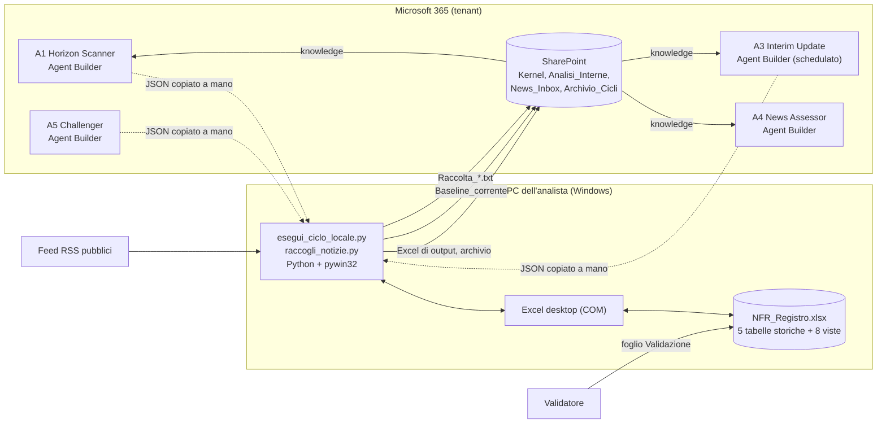

# 1. L'architettura attuale — com'e' fatta, quanto costa, dove e' debole

Riferimento: pacchetto `NFR_Emerging_Risk_Agents/` al 23/09/2026 (suite di
collaudo tutta verde, demo completa rigirata).

> **Aggiornamento del 25/09/2026 sera (struttura del workbook 2026-09-25c,
> DECISIONI D-39 e D-40).** Il registro e il report sono ora un solo file
> ridisegnato; le schede dei rischi sono un file a parte, `Schede_<ciclo>.xlsx`,
> con i testi dell'agente **A6**, che si lancia dopo la validazione con un solo
> allegato preparato dallo script (che ne controlla l'output). I nomi dei fogli
> citati qui si leggono cosi': Dashboard -> **Registro** (tabella per rischio,
> controlli di validazione e copertura) e **Quadro** (report); Sintesi ->
> **Quadro**; Trend -> **Storico**; KRI_Correnti e Andamento_KRI ->
> **Indicatori**; Analisi_News -> **Notizie**; Approfondimento e Schede -> file
> delle schede; Leggimi -> **Guida**; il radar a tre cicli della Dashboard non
> c'e' piu' (lo sostituiscono Matrice e Radar_Mosca). Fogli nuovi: **Matrice**,
> **Piano_azioni**, **Dizionario**. Qualunque alternativa architetturale deve
> riprodurre questa struttura del report e il passo delle schede; il resto del
> documento e' l'analisi com'era alla sua data.
>
> Misure al 25/09 sera, al posto di quelle della sezione 1.2: cinque agenti
> (A1 7.966 caratteri, A5 7.734, A3 6.991, A4 4.873, A6 4.759); template con 20
> fogli in quattro gruppi, 6 tabelle, 9 grafici, circa 8.070 formule e 168 nomi
> definiti (la crescita viene dalle viste ordinate senza formule matriciali e
> dal Dizionario); lo script legge solo nomi definiti, mai celle; passi manuali
> per trimestre: gli stessi piu' `schede-input`, la chat di A6 e `schede`.
>
> **Aggiornamento del 02/10/2026 (D-67, struttura 2026-10-02).** "Foglio
> Validazione" si legge: griglia di lavoro con una riga per rischio, KRI, azione
> e notizia (celle gialle gia' compilate con le proposte, non toccata =
> accettata, Score e Margine di Mosca calcolati mentre si scrive); il dettaglio
> campo per campo e' nel foglio dati Storico_Validazioni, scritto dallo script.

## 1.1 In una figura

Il giudizio sta negli agenti; il calcolo, i controlli, la scrittura e
l'archivio stanno nello script; la memoria sta nel workbook (tabelle storiche)
sincronizzato su SharePoint; la persona valida nel foglio Validazione.

## 1.2 Le misure

| Cosa | Quanto |
|---|---|
| Codice Python | 4.511 righe in 16 file; i due piu' grandi: generatore del template 1.406, script di campo 929 |
| Documentazione | 2.979 righe in 23 file Markdown (guida utente 283, elenco fonti 374, manuale del template 296) |
| Template Excel | 15 fogli, 5 tabelle, 8 grafici, **3.154 formule**, **113 nomi definiti** |
| Prompt | A1 7.884 caratteri su 8.000 (margine 1,5%), A5 7.729, A3 6.946, A4 4.774 |
| Collaudo | 385 verifiche automatiche al momento dell'analisi (mappa 99, controlli 157, fonti 21, riferimenti 27, catena con Excel 81); 414 dopo la revisione del software del 23/09 notte (controlli 162, catena 105) |
| Passi manuali per trimestre | 9: baseline, copia della baseline in Kernel, chat A1 + salvataggio JSON, chat A5 + salvataggio JSON, comando trimestrale, validazione nel foglio (213 righe proposte, la maggior parte accettate in blocco), comando valida, archiviazione dei prompt; piu' l'eventuale ripetizione se A5 o i controlli fermano |
| Passi manuali per settimana | 4-5: file manuali in News_Inbox, chat A3 (o prompt schedulato) + salvataggio JSON, comando settimanale, validazione facoltativa |
| Installazioni | Python 3.10+, pywin32, Excel desktop, sincronizzazione OneDrive delle library; nessun ruolo admin, nessuna API |

## 1.3 Punti di forza (da conservare in qualunque alternativa)

1. **Separazione giudizio/calcolo rigorosa**: nessun numero derivato viene da un
   LLM; lo score composito e l'urgenza sono formule.
2. **Controlli prima della scrittura, con fermo pulito**: schema, C1-C9
   meccanizzati, formule integre, copertura, gate prima del salvataggio; un
   fermo non scrive un byte ed e' archiviato come tentativo.
3. **Tracciabilita' completa**: tabelle storiche solo in coda, Excel congelato
   per ciclo e per settimana, backup, validazione con proposta dell'agente
   conservata accanto alla decisione umana.
4. **Una regola, un posto**: kernel, mappa dei campi, elenco fonti; i prompt si
   compongono; il collaudo verifica i riferimenti incrociati.
5. **Nessuna dipendenza da Power Platform, API o ruoli amministrativi**: si puo'
   installare su un PC con i soli permessi di un utente.
6. **Collaudo eseguibile**: la catena con lo strumento vero ed Excel ha trovato
   difetti che la lettura del codice non avrebbe trovato (date che slittano,
   formule sovrascritte, messaggio falso dopo il salvataggio).

## 1.4 Punti deboli — onesti

| # | Debolezza | Perche' conta | Gravita' |
|---|---|---|---|
| D1 | **Copia a mano del JSON** fra chat dell'agente e file (UTF-8, testo in piu', estensione .txt aggiunta da Blocco note) | e' il passo piu' fragile per un utente non esperto; ogni errore costa un giro | alta |
| D2 | **Dipendenza da un PC** con Python, pywin32, Excel desktop | installazione da concordare con l'IT; se il PC manca, il ciclo si ferma; una sola persona "sa lanciare" | alta |
| D3 | **Il workbook e' il database** | 20.000 righe per tabella, file che cresce a ogni ciclo, 3.154 formule da ricalcolare, un solo scrittore alla volta, una modifica manuale sbagliata nelle tabelle rompe le viste | media |
| D4 | **Un template nuovo non aggiorna il registro in uso** (nessuna migrazione) | ogni miglioramento di viste o grafici arriva solo ai registri nuovi | media-alta |
| D5 | **Generatore monolitico** (1.406 righe: dati di esempio, formule, layout e grafici insieme) e grafici costruiti con openpyxl, che ha molte trappole (overlay, assi nascosti, dati nascosti) | ogni ritocco grafico richiede un esperto e un giro di verifica visiva | media |
| D6 | **Prompt al limite dei caratteri** (A1 al 98,5%) | ogni descrittore aggiunto alla rubrica costringe ad accorciarne altri | media |
| D7 | **Fragilita' di COM**: lingua di Excel, file aperti da altri, versioni di Office | errori tecnici che l'utente non sa interpretare | media |
| D8 | **Validazione verbosa**: 213 righe per trimestre in formato "lungo" | tentazione di accettare in blocco: validazione di facciata | media |
| D9 | **Orchestrazione assente**: Agent Builder non chiama altri agenti, i prompt schedulati sono per utente e non allegano la baseline | tutto il flusso trimestrale e' manuale | media |
| D10 | **Retrieval e qualita' degli agenti mai misurati nel tenant** | i payload di prova sono scritti a mano; il rischio vero (l'agente sbaglia o non trova le fonti) e' tutto da misurare | alta, ma comune a tutte le alternative |

## 1.5 Dove si spende l'impegno di manutenzione

- **Cambiare la metodologia** (rubrica, pesi, tassonomia): facile e protetto
  (fonte unica, ricomposizione, collaudo).
- **Cambiare le viste o i grafici**: difficile (generatore, verifica visiva,
  migrazione mancante).
- **Cambiare i dati raccolti** (una colonna nuova): medio (mappa, schema,
  generatore, dati di prova; il collaudo elenca cosa manca).
- **Esercizio quotidiano**: dipende da una persona che sappia usare il Prompt
  dei comandi e interpretare un fermo.

## 1.6 Cosa ne deriva per le alternative

Le alternative valgono se riducono D1, D2, D3-D5 (gli attriti veri) **senza**
perdere i punti di forza 1-4. D10 non lo risolve nessuna architettura: lo
risolve solo il test in ambiente con un trimestre gia' valutato a mano, ed e'
per questo che il piano di rigenerazione (documento 5) parte dal report e da un
trimestre reale.
