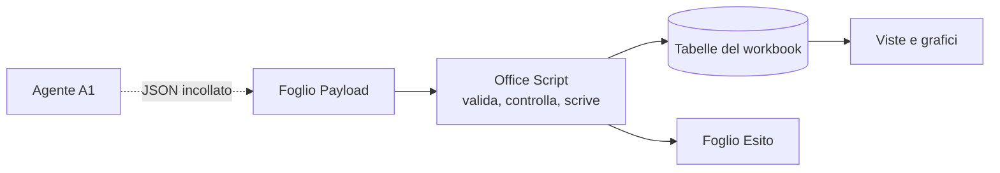
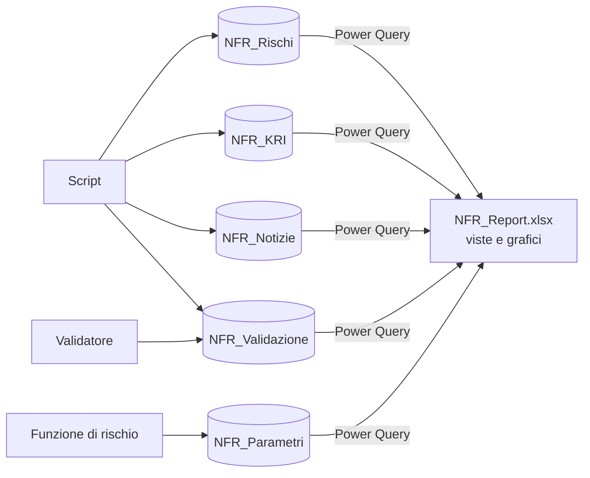

# 2. Alternative con gli STESSI vincoli

> **Aggiornamento del 25/09/2026 sera (struttura del workbook 2026-09-25c,
> DECISIONI D-39 e D-40).** Il registro e il report sono ora un solo file
> ridisegnato; le schede dei rischi sono un file a parte, `Schede_<ciclo>.xlsx`,
> con i testi dell'agente **A6**, che si lancia dopo la validazione con un solo
> allegato preparato dallo script (che ne controlla l'output). I nomi dei fogli
> citati qui si leggono cosi': Dashboard -> **Registro** (tabella per rischio,
> controlli di validazione e copertura) e **Quadro** (report); Sintesi ->
> **Quadro**; Trend -> **Storico**; KRI_Correnti e Andamento_KRI ->
> **Indicatori**; Analisi_News -> **Notizie**; Approfondimento e Schede -> file
> delle schede; Leggimi -> **Guida**; il radar a tre cicli della Dashboard non
> c'e' piu' (lo sostituiscono Matrice e Radar_Mosca). Fogli nuovi: **Matrice**,
> **Piano_azioni**, **Dizionario**. Qualunque alternativa architetturale deve
> riprodurre questa struttura del report e il passo delle schede; il resto del
> documento e' l'analisi com'era alla sua data.

Vincoli mantenuti: solo Microsoft 365 Copilot (agenti in Agent Builder),
**niente Copilot Studio, niente Power Automate**, nessun ruolo amministrativo o
API; la Banca vuole semplicita' di gestione e di modifica; separazione
giudizio/calcolo, tracciabilita' e validazione umana restano obbligatorie.

Quattro alternative, piu' una variante estrema. Non si escludono: C e D, in
particolare, si combinano (vedi documento 4).

---

## A. Excel-nativo: Office Scripts al posto di Python ("nulla Python")

### Idea
Tutta la parte deterministica vive **dentro Excel** come Office Scripts
(TypeScript) salvati su OneDrive o SharePoint e lanciati da un pulsante nel
workbook, anche da Excel per il web. L'analista incolla il JSON dell'agente in
una cella (foglio `Payload`), preme "Scrivi ciclo": lo script valida, applica i
controlli, scrive nelle tabelle, e scrive l'esito in un foglio `Esito`.

### Cosa cambia rispetto a oggi
- Sparisce l'installazione sul PC (D2): basta Excel, anche nel browser.
- Il ricalcolo e' quello vero di Excel, senza COM (D7).
- La raccolta RSS non si puo' fare da uno script (le chiamate esterne falliscono
  se lanciato da flusso, e dal browser i feed sono di solito bloccati dal CORS
  del sito: da verificare). W0 diventa: siti pubblici come knowledge
  dell'agente + file caricati a mano.
- Niente copie "Excel di output" automatiche: uno script non crea file.
  L'archivio si affida alla **cronologia versioni** di SharePoint e a un
  "Salva una copia" manuale, o a un foglio `Archivio` nel workbook.

### Pro
- Zero installazioni, zero dipendenze fuori da Microsoft 365 (era il desiderio
  iniziale: "senza dipendenze esterne al solo Copilot 365").
- Funziona da qualunque PC e dal browser; nessun "PC unico".
- Un solo file da aprire: l'utente non usa mai il Prompt dei comandi.

### Contro
- **Riscrittura** di ~1.000 righe (validatore, controlli, scrittura) in
  TypeScript, dentro l'editor di codice di Excel.
- **Il collaudo automatico si perde quasi tutto**: gli Office Scripts girano
  solo dentro Excel; non esiste un modo semplice per eseguirli in una suite
  automatica. Si torna a test manuali o a una seconda implementazione per i
  test (proprio cio' che l'architettura attuale ha eliminato).
- Lo schema JSON non si importa: le regole vanno ricopiate nello script
  (seconda copia del contratto da tenere allineata allo schema).
- Limiti di piattaforma: 5 MB per richiesta/risposta, alcune API non
  disponibili in Excel desktop, gli script possono essere disattivati
  dall'amministratore.
- L'utente aveva scelto "solo Python, niente TypeScript".

### Variante estrema A-bis: "nessuno script"
Gli agenti restituiscono le righe **gia' in formato tabella** (testo separato da
tabulazioni); l'analista le incolla nelle tabelle; formule e formattazione
condizionale segnalano gli errori (soglie invertite, variazioni > 1 punto,
fonti future) e la persona corregge prima di approvare. Massima semplicita',
ma **il controllo diventa visivo, non un gate**: niente fermo prima della
scrittura, facile incollare nella tabella sbagliata. Accettabile solo per una
fase pilota.

### Quando sceglierla
Se l'installazione di Python sul PC e' impossibile e la Banca accetta di
perdere il collaudo automatico. Altrimenti no.

---

## B. Piu' agenti, piu' piccoli e mirati

### Idea
Spezzare gli agenti grandi in agenti con un compito solo, schema piccolo e
prompt corto. Per esempio:

| Oggi | Domani |
|---|---|
| A1 (valuta tutto: dimensioni, fonti, azioni, KRI, rilettura) | **A1-E Evidenze**: per ogni rischio, solo le evidenze nuove datate con fonte. **A1-S Punteggi**: date le evidenze, solo dimensioni e variazioni. **A1-M Mitigazioni**: azioni e KRI. **A1-K Rilettura KRI**: solo i valori rilevati |
| A3 (tutte le notizie, tutti gli impatti) | **A3-T Triage**: quali notizie sono pertinenti e di quale fonte. **A3-I Impatti**: i sette impatti e il segnale per le notizie tenute |
| A5 (nove controlli) | invariato, oppure due challenger: **metodo** (C1-C5) e **coerenza** (C6-C9) |

Ogni agente ha il suo schema e i suoi controlli; lo script combina i pezzi.

### Pro
- **Prompt lontani dal limite** di 8.000 caratteri (D6): si puo' arricchire la
  rubrica.
- **Qualita' piu' alta e misurabile per pezzo**: un agente che fa solo
  "evidenze" si confronta facilmente con un analista; si sa dove sbaglia.
- Il passo "evidenze" produce una base di fatti datati riusabile anche da A4 e
  dalla validazione umana (il validatore vede le evidenze, non solo i numeri).
- Controlli piu' mirati (es. C3 sulle evidenze prima dei punteggi).

### Contro
- **Senza orchestrazione, ogni agente e' un passo manuale in piu'** (D1, D9
  peggiorano): da 2 chat a trimestre a 4-5, ognuna con un JSON da salvare e
  passare al successivo. E' il costo decisivo in questo ambiente.
- Piu' contratti, piu' prompt, piu' dati di prova da mantenere.
- Il ragionamento spezzato puo' perdere coerenza (punteggi che non tengono
  conto di un'azione gia' in corso): serve un controllo di coerenza fra i pezzi.

### Quando sceglierla
In forma **parziale**: separare solo A1 in "Evidenze" + "Punteggi e
mitigazioni" (due chat invece di una) quando il limite di caratteri o la
qualita' misurata in tenant lo richiedono. In forma piena conviene solo con un
orchestratore (Copilot Studio, documento 3).

---

## C. Piu' workbook specializzati + un workbook di aggregazione e report

### Idea
Separare i dati per responsabilita', ciascuno in un file semplice, e costruire
le viste in un file di report che **legge** i dati con Power Query.

| File | Contenuto | Chi scrive |
|---|---|---|
| `NFR_Rischi.xlsx` | RiskRegister, Azioni, anagrafica | script (trimestrale) |
| `NFR_KRI.xlsx` | storico KRI | script (trimestrale) |
| `NFR_Notizie.xlsx` | NewsLog | script (settimanale) |
| `NFR_Validazione.xlsx` | righe da validare e decisioni | script + validatore |
| `NFR_Parametri.xlsx` | pesi, soglie, tassonomia, parametri dell'urgenza | funzione di rischio |
| `NFR_Report.xlsx` | Quadro, Classifica, Radar_Mosca, Matrice, Delta, Metodologia, Registro, Storico, Indicatori, Notizie, Piano_azioni (struttura D-39) | nessuno: **solo lettura**, si aggiorna con "Aggiorna tutto" |

### Pro
- **Risolve il problema della migrazione (D4)**: i file di dati sono tabelle
  semplici e stabili; il report si puo' rifare o migliorare quando si vuole,
  basta ricollegarlo. Un grafico nuovo arriva subito a tutti.
- **Meno formule-ragnatela (D3, D5)**: le viste diventano query (unione,
  filtri, raggruppamenti) + tabelle pivot/grafici; le 3.154 formule con 113
  nomi definiti si riducono di molto e sono piu' leggibili.
- **Meno conflitti**: il validatore lavora su `NFR_Validazione.xlsx` mentre lo
  script scrive le notizie; i permessi si danno per file (Parametri solo alla
  funzione di rischio).
- File piccoli, veloci da aprire; ogni file ha una responsabilita'.
- Si migra **gradualmente**: si puo' partire staccando solo il report.

### Contro
- **Aggiornamento del report**: Power Query si aggiorna con un clic (o
  all'apertura); va ricordato, e con file su SharePoint servono le credenziali
  giuste (di solito l'account aziendale, da verificare in Excel della Banca).
- Riferimenti a percorsi SharePoint: se si spostano i file, il report va
  ricollegato (un parametro con la cartella base limita il danno).
- Il controllo di copertura e gli altri gate vanno rifatti nello script
  (leggendo i file dati), non piu' letti dal foglio.
- Excel per il web aggiorna le query solo in parte: il report e' da aprire in
  Excel desktop (come oggi).
- Lavoro di rifacimento delle viste: circa una settimana, piu' il collaudo.

### Quando sceglierla
E' l'evoluzione piu' sensata dell'architettura attuale: toglie i due attriti di
manutenzione piu' costosi (migrazione e generatore monolitico) senza toccare
agenti, kernel, controlli e validazione.

---

## D. Livello di presentazione separato: report trimestrale generato, grafici con JavaScript

### Idea
Oggi il "report" e' il workbook stesso. Il comitato pero' legge un documento.
Si aggiunge un **generatore di report** che, dopo la validazione, produce:
1. **Report trimestrale in PowerPoint (o Word)**, generato via COM di Office
   (la stessa tecnica gia' usata per Excel: nessuna libreria nuova): copertina,
   sintesi di A1, tabella dei rischi con variazioni e motivazioni, radar,
   Radar_Mosca, KRI in rosso/ambra, azioni deliberate, rettifiche del
   validatore, limiti dichiarati.
2. Facoltativo: un **report interattivo HTML** con grafici JavaScript (una
   libreria come ECharts o Chart.js **incorporata nel file**, niente internet):
   radar e Radar_Mosca con tooltip (P, I, Z, X, Y, motivazione), filtri per
   event type, storia di un rischio o di un KRI al clic.

### Opzioni per "JavaScript nella parte grafica", valutate

| Opzione | Esito |
|---|---|
| Componente aggiuntivo di Office (Office Add-in) con grafici JS dentro Excel | potente, ma va **distribuito dall'amministratore** (o caricato a mano): quasi impossibile in banca senza IT. Scartata |
| Office Scripts per disegnare grafici | gli script creano grafici **Excel** standard: nessun guadagno rispetto a oggi |
| **Pagina HTML autonoma** con libreria JS incorporata | facile, bella, interattiva; ma SharePoint Online di solito **scarica** i file .html invece di mostrarli (dipende dalle impostazioni del sito: verificare): si apre in locale o da una cartella sincronizzata |
| **Python in Excel** (grafici matplotlib nelle celle) | gira nel cloud Microsoft, senza installazioni, ma non puo' leggere file o rete, restituisce immagini statiche, e richiede la disponibilita' nel tenant: utile per grafici statici particolari, non per la struttura |
| Grafici Excel (oggi) + **immagini esportate nel PowerPoint** | la via piu' robusta per il comitato |

### Pro
- **Il comitato riceve un documento pronto**, sempre uguale nella forma: meno
  lavoro manuale ogni trimestre, meno errori di copia.
- La parte grafica "da vetrina" si puo' curare senza toccare il registro.
- Il report stesso e' un'evidenza archiviabile per ciclo (governance).
- Si aggiunge senza cambiare nulla del resto: e' un modulo in piu'.

### Contro
- Un generatore in piu' da mantenere (la forma del report cambiera').
- PowerPoint via COM ha le stesse fragilita' di Excel via COM (D7).
- La pagina HTML e' un secondo modo di vedere gli stessi dati: va tenuta
  coerente con il workbook (stessa fonte, generata dallo stesso script).

### Quando sceglierla
Subito per il **PowerPoint del comitato** (alto valore, basso rischio). La
pagina HTML solo se gli utenti chiedono esplorazione interattiva e se
l'apertura in locale e' accettabile.

---

## Confronto rapido delle quattro (dettagli nel documento 4)

| | A Office Scripts | B Agenti piccoli | C Piu' workbook + report | D Report generato |
|---|---|---|---|---|
| Installazioni sul PC | nessuna | come oggi | come oggi | come oggi (+ PowerPoint) |
| Passi manuali | meno (niente comandi) | **piu'** | come oggi (+ "Aggiorna tutto") | meno (report automatico) |
| Collaudo automatico | **in gran parte perso** | come oggi | come oggi | come oggi |
| Manutenzione delle viste | come oggi | come oggi | **molto meglio** | meglio (report separato) |
| Migrazione del registro | irrisolta | irrisolta | **risolta** | irrisolta per le viste Excel |
| Qualita' degli agenti | come oggi | **meglio, misurabile** | come oggi | come oggi |
| Impegno | alto (riscrittura) | medio | medio | basso-medio |
