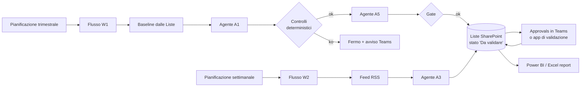
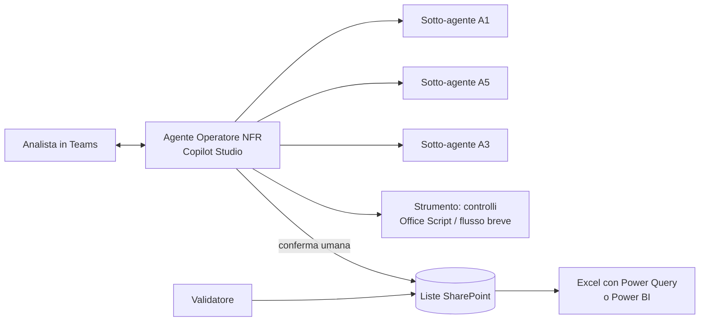

# 3. Alternative che rilassano i vincoli (sempre con Copilot)

> **Aggiornamento del 25/09/2026 sera (struttura del workbook 2026-09-25c,
> DECISIONI D-39 e D-40).** Il registro e il report sono ora un solo file
> ridisegnato; le schede dei rischi sono un file a parte, `Schede_<ciclo>.xlsx`,
> con i testi dell'agente **A6**, che si lancia dopo la validazione con un solo
> allegato preparato dallo script (che ne controlla l'output). I nomi dei fogli
> citati qui si leggono cosi': Dashboard -> **Registro** (tabella per rischio,
> controlli di validazione e copertura) e **Quadro** (report); Sintesi ->
> **Quadro**; Trend -> **Storico**; KRI_Correnti e Andamento_KRI ->
> **Indicatori**; Analisi_News -> **Notizie**; Approfondimento e Schede -> file
> delle schede; Leggimi -> **Guida**; il radar a tre cicli della Dashboard non
> c'e' piu' (lo sostituiscono Matrice e Radar_Mosca). Fogli nuovi: **Matrice**,
> **Piano_azioni**, **Dizionario**. Qualunque alternativa architetturale deve
> riprodurre questa struttura del report e il passo delle schede; il resto del
> documento e' l'analisi com'era alla sua data.

Vincolo rilassato: si usa **Copilot Studio** (e i flussi della Power
Platform). Restano: Microsoft 365 Copilot come piattaforma, separazione
giudizio/calcolo, tracciabilita', validazione umana.

## 3.0 Prima di tutto: il vincolo potrebbe essere piu' debole di quanto sembra

Secondo Microsoft Learn ("Standard harness licensing", agg. 03/08/2026):
- per usare Copilot Studio basta **una** di queste configurazioni, fra cui **"a
  Microsoft 365 Copilot license"** (la licenza che la Banca ha gia');
- l'uso degli agenti in Copilot Chat, Teams o SharePoint da parte di utenti con
  licenza Microsoft 365 Copilot **non consuma crediti** per risposte classiche,
  risposte generative e grounding sul tenant;
- le **azioni** (connettori, flussi) e l'uso oltre questi casi possono invece
  consumare **Copilot Credits** (pacchetti prepagati o pay-as-you-go): la stima
  si fa con l'estimator ufficiale.

Quindi "niente Copilot Studio" puo' essere un **blocco organizzativo** (ambiente
Power Platform non abilitato, ruolo di autore non assegnato, criteri DLP), non
di licenza. **Prima domanda da fare all'IT della Banca:** "possiamo avere un
ambiente Power Platform con il ruolo Copilot Studio authors per 2-3 persone, con
i connettori standard SharePoint, Teams, Approvals ed Excel Online?". Se la
risposta e' si', le due alternative che seguono sono a portata.

Nota sulla piattaforma: Copilot Studio distingue oggi fra *agent flows*
("standard harness", con il nodo **Run a prompt** che puo' restituire **JSON**)
e *workflows* su un harness diverso (Learn, "Add a prompt node to an agent
flow", 25/06/2026). La piattaforma e' stata rifatta a meta' 2026: verificare
nomi e disponibilita' nel tenant prima di progettare.

---

## R1. Pipeline orchestrata: Copilot Studio + flussi + Liste SharePoint + Power BI

### Idea
Il flusso trimestrale e quello settimanale diventano **flussi schedulati**. Gli
agenti A1, A3, A5 sono chiamati dai flussi (nodo agente o prompt con uscita
JSON); lo stato vive in **Liste SharePoint** (una per tabella: rischi, azioni,
KRI, notizie, validazioni), non in un file Excel; l'approvazione umana passa
dalle **Approvals di Teams**; il report e' un **Power BI** collegato alle liste
(o un Excel con Power Query, se Power BI non e' disponibile).

### I controlli deterministici, senza Python
- Lo **schema** con l'azione "Analizza JSON" copre tipi e campi obbligatori, ma
  non pattern, enum, minimi, campi in piu'. Il resto va fatto in un **Office
  Script** chiamato dal flusso (azione "Esegui script"), che riceve il JSON e
  restituisce i rilievi C1-C9 meccanizzati: gli Office Scripts lanciati da flusso
  non possono fare chiamate esterne, ma per calcolare controlli non servono.
  Limiti: circa 120 secondi per esecuzione, 5 MB di richiesta.
- Il **gate di copertura** diventa un conteggio sulle liste nel flusso.
- Lo score composito e l'urgenza di Mosca si calcolano come colonne calcolate
  della lista o, meglio, nel modello del report.

### Pro
- **Nessun passo manuale di copia**, nessun PC dedicato, nessuna installazione
  (D1, D2, D9 risolti): il ciclo parte da solo e chiede alle persone solo cio'
  che spetta loro (approvare, validare).
- **Stato in liste**: interrogabili, con cronologia versioni di ogni elemento
  (audit gratuito), permessi per lista, niente limite di 20.000 righe del
  workbook, niente migrazione del registro (D3, D4).
- **Validazione nativa**: ogni riga da validare e' un elemento con stato e
  cronologia; l'approvazione in Teams lascia traccia di chi e quando.
- **Report sempre aggiornato** (aggiornamento pianificato in Power BI).
- E' la struttura originaria del pacchetto (workflow W0-W3): la specifica
  esiste gia'.

### Contro
- **Piu' pezzi da costruire e governare**: flussi, connessioni, ambienti
  (sviluppo/produzione), soluzioni ALM, criteri DLP. Lo sviluppo e' low-code ma
  richiede qualcuno che conosca la Power Platform.
- **Collaudo piu' difficile**: i flussi non si eseguono in una suite locale;
  serve un ambiente di test e dati di prova caricati nelle liste. Si puo'
  conservare il collaudo dei **contratti** (schemi, regole) in Python, fuori dal
  percorso operativo.
- Consumo di Copilot Credits per azioni e flussi: da stimare.
- **Power BI**: per condividere un report servono licenze Pro (o capacita'
  Premium/Fabric); senza, si ripiega su Excel + Power Query collegato alle
  liste.
- La scrittura su Excel via connettore ha limiti noti (file bloccato fino a 12
  minuti dopo l'uso del connettore, scritture concorrenti non supportate,
  256 righe per lettura senza paginazione): e' il motivo per cui lo stato va
  nelle **liste**, non in un workbook.

### Impegno indicativo
3-5 settimane per una persona esperta di Power Platform, riusando kernel,
schemi, prompt e specifica dei workflow.

---

## R2. Agente operativo conversazionale: Copilot Studio con strumenti + Liste + report

### Idea
Un solo **agente "Operatore NFR"** in Copilot Studio, usato in Teams, che
guida l'analista a conversazione e ha degli **strumenti** (azioni sui
connettori standard) per leggere e scrivere le liste. L'analista scrive
"Prepara il ciclo 2026Q3": l'agente legge la baseline dalle liste, invoca il
sotto-agente di valutazione (A1), presenta le proposte in schede, fa
eseguire i controlli (un Office Script o un flusso breve come strumento),
chiede **conferma esplicita** prima di scrivere, e scrive nelle liste con
stato "Da validare". Il validatore valida da una vista della lista (o da una
scheda in Teams).

### Pro
- **La soluzione piu' semplice da usare e da mantenere**: una conversazione al
  posto di nove passi; niente comandi, niente file JSON da salvare.
- Gli agenti piccoli dell'alternativa B diventano naturali: l'orchestratore
  li chiama in sequenza senza lavoro manuale.
- Molto meno da costruire di R1: pochi strumenti, niente pipeline pianificata
  complessa.
- La persona resta **nel ciclo per costruzione** (conferma prima di ogni
  scrittura).

### Contro
- **Meno deterministico di R1**: e' l'agente a decidere quando chiamare i
  controlli. Va imposto con le istruzioni e, dove possibile, con uno strumento
  unico "controlla e scrivi" che fa entrambe le cose: la scrittura non deve
  essere possibile senza i controlli.
- Nessuna pianificazione: il ciclo parte quando l'analista lo chiede
  (accettabile per un ciclo trimestrale; per il settimanale serve comunque un
  flusso di raccolta).
- Rischio di "validazione di facciata" se la conferma in chat diventa
  automatica: la validazione vera resta sulle liste, con motivazione
  obbligatoria per le rettifiche.
- Stesse considerazioni su crediti, ambienti e DLP di R1, in misura minore.

### Impegno indicativo
2-3 settimane, riusando kernel, schemi e prompt (che diventano istruzioni di
sotto-agenti, senza il limite pratico di un unico prompt da 8.000 caratteri
per tutto il lavoro). E' la stima di una versione minima: il piano completo,
con porting e collaudo dei controlli, e' nel documento 6 (circa 6-7 settimane).

---

## R1 o R2?

| | R1 Pipeline | R2 Agente operativo |
|---|---|---|
| Automazione | massima (pianificato) | su richiesta |
| Determinismo dei controlli | alto (il flusso non salta passi) | medio (va imposto con uno strumento unico) |
| Semplicita' per l'utente | alta (approva e valida) | **massima** (conversa) |
| Semplicita' di costruzione e manutenzione | media | **alta** |
| Collaudo | difficile (ambiente di test) | difficile (ambiente di test) |
| Adatto a | esercizio stabile, piu' utenti, audit | avvio rapido, un piccolo team |

Percorso naturale: **partire da R2** (valore subito, poco da costruire) e
spostare nei flussi di R1 solo cio' che deve girare da solo (raccolta
notizie settimanale, promemoria di validazione, aggiornamento del report).
