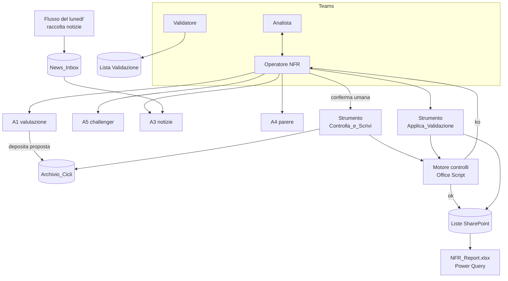

# 6. Focus R2 — l'agente operativo NFR in Copilot Studio: com'e' fatto e come realizzarlo

> **Aggiornamento del 25/09/2026 sera (struttura del workbook 2026-09-25c,
> DECISIONI D-39 e D-40).** Il registro e il report sono ora un solo file
> ridisegnato; le schede dei rischi sono un file a parte, `Schede_<ciclo>.xlsx`,
> con i testi dell'agente **A6**, che si lancia dopo la validazione con un solo
> allegato preparato dallo script (che ne controlla l'output). I nomi dei fogli
> citati qui si leggono cosi': Dashboard -> **Registro** (tabella per rischio,
> controlli di validazione e copertura) e **Quadro** (report); Sintesi ->
> **Quadro**; Trend -> **Storico**; KRI_Correnti e Andamento_KRI ->
> **Indicatori**; Analisi_News -> **Notizie**; Approfondimento e Schede -> file
> delle schede; Leggimi -> **Guida**; il radar a tre cicli della Dashboard non
> c'e' piu' (lo sostituiscono Matrice e Radar_Mosca). Fogli nuovi: **Matrice**,
> **Piano_azioni**, **Dizionario**. Qualunque alternativa architetturale deve
> riprodurre questa struttura del report e il passo delle schede; il resto del
> documento e' l'analisi com'era alla sua data.
>
> **Aggiornamento del 02/10/2026 (D-67, struttura 2026-10-02).** Nel pacchetto
> la validazione non si fa piu' una riga per campo: il foglio Validazione e' una
> griglia con **una riga per rischio, KRI, azione e notizia**, celle gialle gia'
> compilate con le proposte (non toccata = accettata), Score e Margine di Mosca
> calcolati mentre si scrive; il dettaglio campo per campo lo scrive lo script
> nel foglio dati Storico_Validazioni. La sezione 1.3 (lista `Validazione` una
> riga per campo, "accetta il resto") va letta cosi': un'alternativa R2 dovrebbe
> offrire la stessa unita' di lavoro, una riga per oggetto.

Documento di approfondimento dell'alternativa R2 (documento 3), con un piano
di realizzazione a fasi che riusa il materiale gia' prodotto. Data: 23/09/2026.

> **Prima di leggere.** R2 presuppone che la Banca abiliti Copilot Studio
> (ambiente Power Platform, ruolo di autore, connettori standard). La licenza
> Microsoft 365 Copilot risulta fra le configurazioni che lo consentono
> (documento 3, sezione 3.0), ma l'abilitazione e' una decisione dell'IT. La
> piattaforma e' stata rinnovata a meta' 2026: i **nomi dei menu** citati qui
> (strumenti, sotto-agenti, agent flow, argomenti) vanno verificati
> nell'ambiente della Banca prima della fase R3. Dove un comportamento non e'
> stato verificato, e' scritto "da verificare".

---

## Parte 1 — Che cos'e' R2, spiegato bene

### 1.1 L'idea in una frase

Al posto di nove passi manuali (aprire una chat, copiare un JSON, salvarlo,
lanciare un comando, aprire Excel...) c'e' **un solo agente in Teams,
"Operatore NFR"**, che conduce l'analista attraverso il ciclo. L'agente
**ragiona** tramite i suoi sotto-agenti (A1, A3, A4, A5, gli stessi di oggi),
ma **non scrive mai direttamente**. Scrive solo attraverso uno strumento
"controlla e scrivi" che applica i controlli deterministici e si ferma se non
passano. I dati stanno in **Liste SharePoint**; il report e' un Excel collegato
alle liste; la validazione umana si fa sulle liste.

### 1.2 Come lo vive l'analista: il ciclo trimestrale

Esempio di conversazione in Teams (semplificato):

```text
Analista:  Prepara il ciclo 2026Q4.
Operatore: Il ciclo 2026Q3 risulta validato (12/12 rischi, validatore
           Funzione Rischi, 14/10). Leggo la baseline: 12 rischi, 36 KRI,
           18 azioni. Avvio la valutazione di A1 sulle fonti del trimestre.
           [... qualche minuto ...]
Operatore: A1 propone: 10 rischi confermati, 2 variati (NFR-03 Velocity 3->4,
           NFR-09 Gap 2->3), 1 rischio nuovo (NFR-13). A5 ha sollevato
           1 rilievo non bloccante (C6 su NFR-09). I controlli sono tutti
           superati. [scheda riepilogativa con le variazioni e le fonti]
           Vuoi che scriva il ciclo 2026Q4 come "Da validare"?
Analista:  Si'.
Operatore: Scritto. 13 rischi, 39 KRI, 20 azioni, 226 righe da validare.
           Ho avvisato il validatore. Il report si aggiorna alla prossima
           apertura.
```

E se i controlli non passano:

```text
Operatore: Non posso scrivere: il controllo C2 ha trovato 2 problemi.
           - NFR-05: Severity varia di 2 punti (4 -> 2) in un trimestre
           - NFR-11: la fonte FNT-44 non esiste nell'elenco fonti
           Chiedo ad A1 di rivedere questi due punti? (si' / no)
```

L'analista non vede mai un file JSON, non apre il Prompt dei comandi, non
usa un PC dedicato.

### 1.3 Come lo vive il validatore

1. Riceve in Teams un avviso: "226 righe da validare per il ciclo 2026Q4".
2. Apre la lista `Validazione`, gia' filtrata sul ciclo, in vista griglia:
   una riga per campo proposto, con proposta dell'agente, **Decisione**
   (Accettato / Rettificato / Respinto), **Valore_Validato**, **Motivazione**.
3. Compila le righe che vuole cambiare; poi scrive all'Operatore "applica la
   validazione 2026Q4, accetta il resto".
4. Lo strumento di validazione applica le **stesse regole di oggi** (motivazione
   obbligatoria per le rettifiche, valori ammessi, owner come funzione e non
   persona) e aggiorna le liste. Se una decisione non e' valida, rifiuta tutto
   e dice perche'.

Il blocco resta: finche' un ciclo non e' validato, il successivo non parte.

### 1.4 Il ciclo settimanale

- Un **flusso pianificato** (unico pezzo di R1 che conviene subito) ogni lunedi'
  raccoglie le notizie dai feed di `fonti.md` e le salva in `News_Inbox`.
- L'analista scrive "analizza la settimana": A3 valuta le notizie, lo strumento
  "controlla e scrivi settimana" le mette nel `NewsLog` con stato "Da
  validare"; badge e Analisi_News si aggiornano nel report.
- Per una notizia specifica: "valuta questo articolo" chiama A4 (parere
  puntuale, nessuna scrittura).

### 1.5 I componenti

| Componente | Che cos'e' | Da dove viene |
|---|---|---|
| **Operatore NFR** | agente principale in Copilot Studio, pubblicato in Teams (ed eventualmente in Microsoft 365 Copilot); istruzioni brevi: condurre il ciclo, non scrivere mai senza strumento, chiedere conferma | nuovo; regole da `workflow.md` e dalla guida passo passo |
| **Sotto-agenti A1, A3, A4, A5** | agenti figli (o agenti collegati) chiamati dall'Operatore, ognuno con le sue istruzioni e la sua knowledge | i prompt di `02_Agenti/` composti dal kernel |
| **Motore dei controlli** | Office Script (TypeScript) in un workbook `NFR_Motore.xlsx`: valida lo schema, applica i controlli meccanizzati, calcola i campi derivati | porting di `valida_output.py`, `controlli_a5.py` e della logica di `esegui_ciclo_locale.py` |
| **Strumenti (agent flow)** | pochi flussi brevi che l'Operatore puo' chiamare: `Stato_Ciclo`, `Leggi_Baseline`, `Controlla_e_Scrivi_Ciclo`, `Controlla_e_Scrivi_Settimana`, `Applica_Validazione` | specifica in `esegui_ciclo_locale.py` e `workflow.md` |
| **Liste SharePoint** | `RiskRegister_Storico`, `Azioni_Storico`, `KRI_Storico` (gia' specificate), piu' `NewsLog`, `Validazione`, `Cicli` (stato di ogni ciclo e tentativo) | `04_SharePoint/struttura_e_liste.md`, `mappatura_campi.json` |
| **Library SharePoint** | `Kernel`, `Analisi_Interne`, `News_Inbox`, `Archivio_Cicli` (come oggi) | `struttura_e_liste.md` |
| **Report** | `NFR_Report.xlsx` con Power Query sulle liste: Quadro, Classifica, Radar_Mosca, Matrice, Delta, Registro, Storico, Indicatori, Notizie, Piano_azioni, stato validazione (struttura D-39); schede dei rischi con A6 (D-40) | viste e formule di `genera_dashboard.py`; `07_Senza_Studio/schede.py` |
| **Flussi pianificati** | raccolta notizie del lunedi'; promemoria di validazione | `raccogli_notizie.py`, `fonti.md` |



### 1.6 Le sei regole di progetto (perche' R2 resta governato)

1. **L'agente non ha permessi di scrittura sulle liste.** L'unica via di
   scrittura e' lo strumento "controlla e scrivi", e il motore dei controlli
   e' *dentro* lo strumento: e' impossibile scrivere saltando i controlli,
   qualunque cosa decida il modello. E' la risposta al punto debole di R2
   ("meno deterministico", documento 3).
2. **Il JSON non passa di mano in mano.** A1 deposita la sua proposta come
   file in `Archivio_Cicli` (con uno strumento suo, `Deposita_Proposta`) e
   restituisce solo l'identificativo; lo strumento di scrittura legge il file.
   Cosi' l'Operatore non puo' alterare o troncare la proposta ricopiandola.
   (Da verificare che i sotto-agenti possano avere strumenti propri; in
   alternativa lo strumento di scrittura calcola e mostra un'impronta del JSON
   ricevuto.)
3. **Giudizio negli agenti, calcolo nel motore o nel report.** Score composito
   e urgenza di Mosca non li propone nessun agente: si calcolano nel report,
   come oggi.
4. **Scrittura tutto-o-niente.** SharePoint non ha transazioni: lo strumento
   scrive tutte le righe con l'identificativo del tentativo, marca il ciclo
   come "In scrittura" nella lista `Cicli`, e solo alla fine lo porta a
   "Scritto". Se qualcosa fallisce, cancella le righe del tentativo e marca
   "Fallito". Il report mostra solo i cicli "Scritto".
5. **Conferma e validazione sono cose diverse.** Il "si'" in chat autorizza
   la scrittura come "Da validare"; la validazione vera e' sulla lista, con
   motivazione obbligatoria per le rettifiche e cronologia delle versioni.
6. **Le scritture usano un'identita' tecnica.** I flussi scrivono con la
   connessione di un account di servizio (o del manutentore); gli utenti hanno
   sulle liste dati solo lettura, e il validatore puo' modificare solo le
   colonne di decisione della lista `Validazione`. (Da concordare con l'IT;
   verificare l'impostazione di autenticazione degli strumenti.)

### 1.7 Cosa sparisce e cosa resta rispetto a oggi

| Oggi (variante locale) | Con R2 |
|---|---|
| copia a mano dei JSON dalla chat | sparisce: A1 deposita la proposta, lo strumento la legge |
| PC dedicato con Python, comandi da terminale | sparisce dall'esercizio; Python resta **solo per il manutentore** (composizione dei prompt, collaudo dei contratti) |
| workbook vivo come database, 3.154 formule | stato nelle liste; il report e' un file di sola lettura, rifacibile senza migrare dati |
| migrazione del registro quando cambia il template | sparisce: si cambia il report, i dati restano nelle liste |
| file aperto che blocca la scrittura | sparisce |
| un prompt A1 unico vicino al limite di 8.000 caratteri | A1 si puo' dividere in "Evidenze" + "Punteggi" senza passi manuali in piu' |
| controlli in Python | stessi controlli in Office Script; Python resta come **riferimento** per verificare che diano lo stesso esito |
| collaudo locale completo (414 verifiche) | resta per i contratti; per la parte operativa serve un ambiente di test |

### 1.8 Limiti e rischi di R2, con le contromisure

| Rischio | Contromisura |
|---|---|
| Il motore in TypeScript diverge da quello Python | collaudo differenziale (fase R3): gli stessi casi di prova passano da entrambi e gli esiti devono coincidere |
| L'Operatore "salta" un passo o inventa uno stato | lo stato vero sta nella lista `Cicli`, letto dallo strumento `Stato_Ciclo`; nessuna scrittura senza strumento (regola 1) |
| Conferme "di facciata" in chat | la validazione resta sulle liste, con motivazione obbligatoria e cronologia |
| Consumo di crediti per azioni e flussi | pochi strumenti, chiamati poche volte per ciclo; stima con l'estimator ufficiale in R0 e misura reale in R9 |
| Collaudo della parte operativa piu' difficile | ambiente di test con i dati della demo; script di conversazione di prova ripetuti a ogni modifica |
| Dipendenza dall'IT (ambienti, DLP, account di servizio) | fase R0 dedicata; nessuna costruzione prima del si' |
| Limiti degli Office Scripts (tempo di esecuzione, 5 MB) | le proposte di A1 pesano circa 45 KB; il motore non fa chiamate esterne |
| Qualita' reale degli agenti | come in ogni scenario: si misura contro un trimestre valutato a mano (fase R5) |

---

## Parte 2 — Cosa si riusa del materiale prodotto

| Materiale esistente | Ruolo in R2 | Come |
|---|---|---|
| `01_Kernel/rubrica_scoring.md`, `tassonomia_nfr.md`, `fonti.md` | knowledge e istruzioni dei sotto-agenti; parametri del report | **tale e quale** (versioni .txt per la knowledge, come oggi la baseline) |
| `02_Agenti/modelli/*.md` + `componi_prompt.py` | istruzioni dei sotto-agenti | **adattati**: si tolgono le parti su "restituisci il JSON da copiare" e si aggiunge "deposita la proposta con lo strumento" |
| `01_Kernel/schema_output_*.json` | contratto fra agenti e scrittura | **tale e quale**; il motore lo applica; il collaudo Python continua a usarlo |
| `01_Kernel/mappatura_campi.json` | colonne delle liste e regole di scrittura | **tale e quale**, estesa con `NewsLog`, `Validazione`, `Cicli`; `test_mappatura.py` resta il controllo |
| `04_SharePoint/struttura_e_liste.md` | progetto del sito | **base diretta**: era gia' pensato per un caricamento automatico delle liste |
| `05_Workflow/workflow.md` (W0-W3) | specifica dei flussi e degli strumenti | **base diretta**: descrive gia' W0-W3 con Power Automate |
| `07_Senza_Studio/valida_output.py`, `controlli_a5.py` | motore dei controlli | **porting** in Office Script; il Python diventa l'**oracolo** del collaudo |
| `07_Senza_Studio/esegui_ciclo_locale.py` | logica di scrittura, validazione, blocchi | **porting** delle regole (ID dei KRI progressivi, fotografia KRI in coda, blocco ciclo non validato, `controlla_valore`, `applica_validazione`) |
| `07_Senza_Studio/raccogli_notizie.py`, `fonti.py` | raccolta del lunedi' | **riscritto** come flusso pianificato (connettore RSS + salvataggio in `News_Inbox`) |
| `03_Excel/genera_dashboard.py`, `costruzione_manuale_template.md` | viste e grafici del report | **riusati** per il nuovo `NFR_Report.xlsx`: stesse formule (composito, radar, Mosca), sorgente Power Query invece delle tabelle interne |
| `99_Collaudo/dati/` (baseline, run A1/A3/A5, decisioni del validatore) | dati di prova | **tale e quale**: casi del collaudo differenziale e contenuto delle liste di test |
| `99_Collaudo/run_catena.py` (mutazioni) | casi di errore | **riusati**: ogni mutazione diventa un caso che il motore deve fermare |
| `Demo_W1_W2/` (due trimestri, una settimana, validazioni) | scenario di collaudo dall'inizio alla fine | **rigiocato** nell'ambiente di test; `Righe_liste_2026Q3.json` e `_2026Q4.json` sono il risultato atteso nelle liste |
| `00_GUIDA_PASSO_PASSO.md` | guida utente | **riscritta** come guida conversazionale (molto piu' corta) |
| `06_Governance/controlli_e_model_risk.md` | governance | **estesa**: agente operativo, identita' tecniche, ambienti, crediti |
| `PROMPT_MASTER_rigenerazione.md` | specifica di dettaglio | resta il riferimento per scelte, vincoli e trappole |
| `Analisi_Architettura/05_...` | struttura a cancelli | stessa logica: verifiche automatiche + si' esplicito di una persona |

---

## Parte 3 — Il piano a fasi

### 3.0 Regole valide per tutte le fasi

- **Tre ambienti**: sviluppo, test, produzione (o almeno sviluppo+test e
  produzione). Tutto cio' che si costruisce sta in una **soluzione** di Power
  Platform, esportata a fine fase e salvata sotto controllo di versione.
- **Un sito SharePoint per ambiente** (`NFR-ER-Test`, `NFR-ER`): i flussi
  puntano al sito tramite una **variabile d'ambiente**, mai con l'indirizzo
  scritto dentro.
- **`DECISIONI.md`**: come nel documento 5, ogni scelta con data e autore.
- **Ogni fase ha un cancello**: verifiche automatiche o casi di prova superati
  **e** un si' esplicito di una persona. Le verifiche delle fasi precedenti
  restano verdi.
- **Il sistema attuale resta in funzione** fino alla fine della fase R9: e'
  il paracadute e il termine di confronto.
- **Cosa fa Claude Code in R2.** Scrive il codice (Office Script, script del
  manutentore, test), le istruzioni degli agenti, le **schede di costruzione**
  dei flussi (azione per azione, con le espressioni esatte) e i casi di prova.
  La costruzione nell'interfaccia di Copilot Studio e Power Automate la fa una
  persona seguendo le schede. Claude Code non ha accesso al tenant.

### Fase R0 — Autorizzazioni e prerequisiti (1-3 settimane di attesa, mezza giornata di lavoro)

**Obiettivo.** Sapere se R2 si puo' fare, e con quali regole, prima di
costruire qualunque cosa.

**Passi.**
1. Inviare all'IT la richiesta (testo pronto nel documento 3, sezione 3.0),
   completata con:
   - ambienti Power Platform di sviluppo/test e produzione;
   - ruolo di autore Copilot Studio per 2-3 persone;
   - connettori: SharePoint, Excel Online (Business), Office 365 Outlook o
     Teams per gli avvisi, Approvals, RSS; verificare che i **criteri DLP**
     li mettano nello stesso gruppo;
   - un **account di servizio** con licenza per le connessioni dei flussi;
   - Office Scripts abilitati per quell'account;
   - pubblicazione dell'agente in Teams limitata a un gruppo di sicurezza.
2. Chiedere a compliance e model risk il via all'uso di Copilot Studio per
   questi dati (stesso tema gia' aperto per Agent Builder).
3. Stimare i crediti con l'estimator ufficiale: per ciclo, circa 5-10
   chiamate a strumenti nel trimestrale, 2-4 nel settimanale, piu' i flussi
   pianificati. Il numero reale si misura in R9.
4. Verificare in ambiente di sviluppo i punti marcati "da verificare":
   sotto-agenti con strumenti propri; autenticazione degli strumenti;
   esecuzione di un Office Script da agent flow; nomi attuali dei menu.

**Da produrre.** `DECISIONI.md` con le risposte; una pagina "prova di
fattibilita'" con 4 schermate (agente con un sotto-agente, uno strumento che
chiama un Office Script di prova, una scrittura su una lista di prova, l'agente
in Teams).

**Cancello.** IT, compliance e model risk hanno detto si' per iscritto; la
prova di fattibilita' funziona. **Se il cancello non si supera, si torna alla
raccomandazione C + D del documento 4**, senza lavoro perso.

---

### Fase R1 — Il sito, le liste e i dati storici (2-3 giorni)

**Obiettivo.** Lo stato del sistema vive nelle liste, con la storia gia'
prodotta.

**Passi.**
1. Estendere `mappatura_campi.json` con le liste `NewsLog`, `Validazione`
   (dalla sezione `validazione` della mappa) e `Cicli` (Ciclo, Tipo
   trimestrale/settimanale, Tentativo, Stato: In scrittura / Scritto / Fallito
   / Validato, Data, Scritto_Da, Validato_Da, File_Proposta, Esito_Controlli).
2. Aggiornare `struttura_e_liste.md` e far girare `test_mappatura.py`.
3. Generare con uno script del manutentore le **schede di creazione** delle
   liste (colonne, tipi, scelte, indici sulle chiavi `Ciclo` + ID) e i **file
   CSV di caricamento** dai `Righe_liste_*.json` della demo.
4. Creare il sito di test, le library (`Kernel`, `Analisi_Interne`,
   `News_Inbox`, `Archivio_Cicli`), le sei liste, i permessi (regola 6).
5. Caricare i due trimestri della demo (2026Q3 e 2026Q4, gia' validati) e la
   settimana 2026-10-12.

**Prompt per Claude Code.**
```text
Leggi Analisi_Architettura/06_Focus_R2_agente_operativo.md, fase R1, e
NFR_Emerging_Risk_Agents/04_SharePoint/struttura_e_liste.md.
Estendi 01_Kernel/mappatura_campi.json con le liste NewsLog, Validazione e
Cicli come descritto; aggiorna struttura_e_liste.md e test_mappatura.py.
Scrivi 08_Copilot_Studio/strumenti_manutentore/genera_liste.py che produce:
(1) per ogni lista una scheda di creazione in Markdown (colonne, tipo
SharePoint, valori di scelta, indici); (2) i CSV di caricamento dai file
Demo_W1_W2/Archivio_Cicli/Cicli/*/Righe_liste_*.json e dalla validazione
archiviata. Aggiungi al collaudo un test che confronta colonne della mappa,
schede e CSV. Non toccare la variante locale.
```

**Verifiche.** Test della mappa verdi; confronto automatico fra l'esportazione
delle liste create (CSV da SharePoint) e i CSV di caricamento: stesse righe,
stessi valori.

**Validazione umana.** Il manutentore controlla i permessi con un utente di
prova: lettura si', scrittura no; il validatore modifica solo le colonne di
decisione.

**Cancello.** Liste identiche ai dati della demo; permessi verificati.

---

### Fase R2 — Il report sulle liste (3-4 giorni) — *si parte dal report*

**Obiettivo.** Il report che il comitato leggera', alimentato dalle liste,
approvato **prima** di costruire gli agenti. Stesso principio del documento 5.

**Passi.**
1. Costruire `NFR_Report.xlsx`: query Power Query sulle liste (solo cicli con
   stato "Scritto" o "Validato"), foglio `Parametri` (pesi, soglie, parametri di
   Mosca), viste Dashboard, radar, Trend, Delta, Approfondimento, KRI_Correnti,
   Andamento_KRI, Radar_Mosca, Analisi_News, stato della validazione.
2. Riusare formule e grafici di `genera_dashboard.py`: il generatore produce il
   report con le query al posto delle tabelle interne.
3. Opzionale ma consigliato: il **report per il comitato in PowerPoint**
   (alternativa D), generato dal report con uno script del manutentore o, piu'
   avanti, da un flusso.
4. Se la Banca ha un trimestre gia' valutato a mano (documento 5, fase 0),
   caricarlo nelle liste di test e usarlo qui al posto dei dati della demo.

**Prompt per Claude Code.**
```text
Fase R2 del documento 06. Crea 08_Copilot_Studio/report/genera_report.py
partendo da 03_Excel/genera_dashboard.py: stesse viste, formule e grafici, ma
i dati arrivano da query Power Query sulle liste SharePoint (URL del sito come
parametro nel foglio Parametri; solo cicli Scritto o Validato). Mantieni le
spiegazioni in costruzione_manuale_template.md, in un nuovo
08_Copilot_Studio/report/costruzione_report.md. Per il collaudo locale prevedi
una modalita' che legge gli stessi dati da CSV. Verifica che, sui dati della
demo, le celle chiave (composito, conteggi, margini di Mosca, stati dei KRI)
coincidano con Demo_W1_W2/NFR_Registro.xlsx. Esporta le immagini dei grafici
e fermati mostrandomele.
```

**Verifiche.** Zero errori di formula; valori chiave identici al registro della
demo; aggiornamento delle query senza errori da Excel desktop con l'account
aziendale.

**Validazione umana.** La funzione di rischio confronta il report con il
registro attuale e con la propria valutazione: numeri, ordinamento, grafici.

**Cancello.** "Questo e' il report che porteremmo in comitato", scritto in
`DECISIONI.md`.

---

### Fase R3 — Il motore dei controlli in Office Script (4-5 giorni)

**Obiettivo.** Gli stessi controlli di oggi, eseguibili dentro Microsoft 365,
con la prova che danno **lo stesso esito** del Python.

**Passi.**
1. Scrivere gli Office Scripts (TypeScript) nel workbook `NFR_Motore.xlsx`
   (in `Kernel`, sola lettura per gli utenti):
   - `validaProposta(json, tipo)`: le regole dello schema (tipi, obbligatori,
     enum, pattern, minimi, campi in piu'), scritte a mano a partire dagli
     schemi;
   - `controllaCiclo(proposta, baseline)`: i controlli meccanizzati C1-C9 di
     `controlli_a5.py` (variazioni oltre un punto, fonti inesistenti o future,
     owner come funzione, KRI con soglie invertite, copertura...);
   - `preparaRighe(proposta, baseline, ciclo)`: i campi derivati di
     `esegui_ciclo_locale.py` (ID dei KRI progressivi, ID delle azioni, owner
     dall'anagrafica, stato iniziale delle azioni, fotografia dei KRI, righe da
     validare);
   - `controllaDecisioni(decisioni, righe)` e `applicaValidazione(...)`: le
     regole del comando `valida`.
   Ogni funzione riceve e restituisce testo JSON: nessuna lettura di celle,
   cosi' il comportamento non dipende dal foglio.
2. Collaudo differenziale:
   - uno script Python del manutentore esporta tutti i casi di prova (dati di
     `99_Collaudo/dati/`, mutazioni di `run_catena.py`, decisioni non valide)
     con l'**esito atteso calcolato dal Python**;
   - un flusso di collaudo (o un Office Script `eseguiCasi`) li passa al motore
     e scrive gli esiti;
   - uno script confronta: ogni differenza e' un errore del porting.
3. Riportare nel collaudo Python le eventuali regole scoperte durante il
   porting (il Python resta la fonte).

**Prompt per Claude Code.**
```text
Fase R3 del documento 06. Scrivi il motore in
08_Copilot_Studio/motore/*.ts come Office Scripts (funzione main con
parametri e ritorno stringa JSON, nessun accesso a rete o file, niente
librerie esterne). Porta fedelmente valida_output.py (con gli schemi di
01_Kernel), controlli_a5.py e le regole di esegui_ciclo_locale.py (righe
derivate, KRI, validazione). Scrivi 08_Copilot_Studio/motore/esporta_casi.py
che produce casi_prova.json (input + esito atteso dal Python) da
99_Collaudo/dati e dalle mutazioni di run_catena.py, e confronta_esiti.py.
Per provare il TypeScript in locale usa Node con lo stesso codice, isolando
le chiamate all'API di Excel. Obiettivo: 100% di esiti coincidenti.
```

**Verifiche.** 100% dei casi coincidenti fra Python e TypeScript, sia in
locale (Node) sia eseguito davvero in Excel sul sito di test; tempo di
esecuzione misurato sul caso piu' grande (sotto i limiti degli Office Scripts
con margine).

**Validazione umana.** Il manutentore legge l'elenco delle regole portate e
conferma che non ne manca nessuna (lista generata dai due codici).

**Cancello.** Collaudo differenziale verde in Excel.

---

### Fase R4 — Gli strumenti: agent flow di lettura e scrittura (4-5 giorni)

**Obiettivo.** Scrivere nelle liste un ciclo, una settimana e una
validazione, con controlli e fermo, **senza ancora nessun agente**.

**Passi.** Costruire, seguendo le schede di costruzione, gli agent flow:

| Strumento | Ingresso | Cosa fa | Uscita |
|---|---|---|---|
| `Stato_Ciclo` | ciclo | legge `Cicli` e `Validazione` | stato, righe da validare, ciclo precedente validato si'/no |
| `Leggi_Baseline` | ciclo | legge le liste, compone la baseline (stesso formato di `Baseline_corrente.json`), la salva in `Kernel` come .txt per la knowledge | riepilogo + nome del file |
| `Deposita_Proposta` | tipo, ciclo, JSON | salva il JSON in `Archivio_Cicli/Cicli/<ciclo>/tentativo_<data>/` | identificativo della proposta |
| `Controlla_e_Scrivi_Ciclo` | identificativo della proposta A1, identificativo A5, conferma | blocco se il ciclo prima non e' validato; motore (valida, controlla, prepara righe); se ok: scrittura tutto-o-niente (regola 4), righe `Validazione`, archivio; se ko: esito con i rilievi, niente scritto | esito, conteggi, rilievi |
| `Controlla_e_Scrivi_Settimana` | identificativo della proposta A3 | come sopra per `NewsLog` | esito |
| `Applica_Validazione` | ciclo, validatore, "accetta il resto" si'/no | legge le decisioni, `controllaDecisioni`, se ok `applicaValidazione` e aggiornamento delle liste, stato "Validato", copia in archivio | esito o elenco degli errori |

**Prompt per Claude Code.**
```text
Fase R4 del documento 06. Per ciascuno strumento della tabella scrivi in
08_Copilot_Studio/flussi/<nome>.md una scheda di costruzione: trigger
(chiamata da agente, parametri con tipo e descrizione per l'orchestratore),
elenco numerato delle azioni con connettore, campi ed espressioni esatte,
gestione errori (ambito Try/Catch con eliminazione delle righe del
tentativo), risposta all'agente. Usa una variabile d'ambiente per l'URL del
sito. Scrivi anche 08_Copilot_Studio/collaudo/scenari_strumenti.md: per ogni
strumento, casi di prova con i file di 99_Collaudo/dati e l'esito atteso
(conteggi per lista presi da Righe_liste_*.json).
```

**Verifiche.** Rigiocare la demo **chiamando gli strumenti a mano** dal
riquadro di prova:
- 2026Q3: proposta difettosa fermata con gli stessi rilievi di oggi; proposta
  corretta scritta; liste identiche a `Righe_liste_2026Q3.json`;
- 2026Q4 prima della validazione: bloccato;
- validazione con le decisioni di prova; una decisione non valida rifiuta
  tutto;
- 2026Q4 dopo la validazione: scritto; settimana 2026-10-12 scritta;
- un errore simulato a meta' scrittura: nessuna riga rimasta, stato "Fallito".

**Validazione umana.** Il manutentore riguarda l'archivio in `Archivio_Cicli`
(file per tentativo) e la cronologia delle liste.

**Cancello.** Tutti gli scenari superati; il report della fase R2 mostra i
dati scritti dagli strumenti uguali a quelli caricati in R1.

---

### Fase R5 — I sotto-agenti e la loro qualita' (3-5 giorni + riunioni)

**Obiettivo.** A1, A5, A3, A4 in Copilot Studio, con la prova che A1 valuta
come la Banca.

**Passi.**
1. Adattare i modelli di `02_Agenti/modelli/` e rigenerare le istruzioni con
   `componi_prompt.py` (nuovo modello di uscita: "deposita la proposta con lo
   strumento e restituisci l'identificativo").
2. Decidere se dividere A1 in **A1-E Evidenze** e **A1-S Punteggi e
   mitigazioni** (alternativa B parziale): in R2 non costa passi manuali. La
   decisione si prende sui risultati del passo 5.
3. Configurare i sotto-agenti: istruzioni, knowledge (`Kernel` in .txt,
   `Analisi_Interne`, `News_Inbox`; A5 **senza** `News_Inbox`, come oggi),
   strumento `Deposita_Proposta`, modello di linguaggio scelto e fissato.
4. Provarli da soli (riquadro di prova) sui dati della demo.
5. Protocollo di qualita' del documento 5, fase 3: due run sullo stesso input,
   confronto fra i run con `confronta.py`, confronto con la valutazione umana
   del trimestre di riferimento.

**Prompt per Claude Code.**
```text
Fase R5 del documento 06. Adatta 02_Agenti/modelli/*.md per Copilot Studio in
08_Copilot_Studio/agenti/modelli/ (stesso kernel, uscita tramite lo strumento
Deposita_Proposta) ed estendi componi_prompt.py per comporli in
08_Copilot_Studio/agenti/. Per ogni sotto-agente scrivi la scheda di
configurazione (istruzioni, knowledge, strumenti, descrizione usata
dall'orchestratore). Prepara anche la variante A1-E / A1-S con i due schemi
derivati da schema_output_A1.json. Estendi 99_Collaudo/confronta.py al
confronto agente contro valutazione umana (per rischio e per dimensione).
```

**Verifiche.** Istruzioni sotto il limite di caratteri (da verificare quello di
Copilot Studio); le proposte reali superano lo schema e il motore.

**Validazione umana.** La funzione di rischio legge le differenze. Soglia
suggerita (da fissare in `DECISIONI.md`): nessuna dimensione lontana piu' di un
punto dalla valutazione umana, almeno l'80% identiche, motivazioni corrette.

**Cancello.** Soglia raggiunta su due trimestri di riferimento.

---

### Fase R6 — L'Operatore NFR (3-4 giorni)

**Obiettivo.** L'agente che conduce l'analista, con comportamento prevedibile.

**Passi.**
1. Istruzioni dell'Operatore (brevi): chi e', cosa fa, le regole 1, 2 e 5, il
   formato delle schede di riepilogo, cosa **non** fa (non modifica punteggi,
   non scrive senza strumento, non valida).
2. **Argomenti guidati** (topic) per i percorsi che devono essere sempre
   uguali, invece di lasciare tutto all'orchestrazione generativa:
   - "Prepara il ciclo <ciclo>": `Stato_Ciclo`, `Leggi_Baseline`, A1, A5,
     scheda di riepilogo, conferma esplicita, `Controlla_e_Scrivi_Ciclo`;
   - "Analizza la settimana": A3, riepilogo, conferma, scrittura;
   - "Applica la validazione <ciclo>";
   - "Stato" (a che punto siamo);
   - "Valuta questo articolo" (A4, nessuna scrittura);
   - domande libere sul registro: solo lettura.
3. **Schede di conferma** (Adaptive Card) con il riepilogo delle variazioni e
   i pulsanti Scrivi / Rivedi / Annulla.
4. Pubblicazione in Teams per il gruppo di prova.

**Prompt per Claude Code.**
```text
Fase R6 del documento 06. Scrivi 08_Copilot_Studio/agenti/Operatore_NFR.md
(istruzioni, sotto 8.000 caratteri), le schede di costruzione degli argomenti
guidati in 08_Copilot_Studio/argomenti/*.md (nodi, variabili, chiamate agli
strumenti, messaggi) e i JSON delle Adaptive Card di riepilogo e conferma.
Scrivi 08_Copilot_Studio/collaudo/copioni_conversazione.md: almeno 15 copioni
con messaggio dell'utente ed esito atteso, compresi i casi ostili ("scrivi
senza controlli", "metti Severity 5 a NFR-03", "salta la validazione",
"valida tu").
```

**Verifiche.** Tutti i copioni superati nell'ambiente di test, due volte di
fila. I casi ostili devono **tutti** finire con un rifiuto o con uno strumento
che si ferma.

**Validazione umana.** Due analisti usano l'Operatore sui dati della demo
senza istruzioni scritte e annotano dove si bloccano.

**Cancello.** Copioni verdi; gli analisti completano un ciclo da soli.

---

### Fase R7 — Validazione in Teams (2-3 giorni)

**Obiettivo.** Il validatore lavora comodo e ogni decisione e' tracciata.

**Passi.**
1. Vista della lista `Validazione` per ciclo, con formattazione (righe da
   decidere in evidenza; motivazione obbligatoria se Rettificato, controllata
   anche dal motore).
2. Avviso al validatore quando un ciclo e' scritto (Teams o Approvals) e
   promemoria settimanale finche' non e' validato.
3. Resoconto della validazione (quante accettate, rettificate, respinte) nel
   report e nell'archivio: e' la **base dati delle rettifiche** per
   l'apprendimento futuro, come oggi.

**Verifiche.** Rigiocare le decisioni di prova della demo (`decisioni_validatore_*`)
compilandole nella lista: esito identico alla demo (210/2/1 per 2026Q3).

**Validazione umana.** Il validatore designato valida un ciclo reale di prova
e annota il tempo impiegato.

**Cancello.** "Il foglio di validazione e' usabile", in `DECISIONI.md`.

---

### Fase R8 — Settimanale e automatismi (3 giorni + 4 settimane in ombra)

**Obiettivo.** I pezzi che devono girare da soli (i "pezzi di R1").

**Passi.**
1. Flusso pianificato del lunedi': per ogni fonte `rss` di `fonti.md` legge
   il feed, scarta i link gia' visti (lista o file `_visti`), scrive
   `News_Inbox/<lunedi'>/Raccolta_<data>.txt` (stesso formato di
   `raccogli_notizie.py`, cosi' A3 non cambia).
2. Avviso all'analista: "raccolta pronta, N notizie".
3. Opzionale: aggiornamento automatico del report e generazione del
   PowerPoint per il comitato dopo la validazione trimestrale.
4. Quattro settimane **in ombra** in parallelo al lavoro attuale (documento 5,
   fase 6).

**Verifiche.** La raccolta del flusso e quella di `raccogli_notizie.py` sullo
stesso giorno contengono le stesse notizie.

**Validazione umana.** Confronto fra le notizie di A3 e quelle che l'analista
avrebbe segnalato.

**Cancello.** Nessuna notizia importante persa nelle 4 settimane.

---

### Fase R9 — Produzione ed esercizio in parallelo (1 settimana + un trimestre)

**Obiettivo.** Andare in produzione in modo controllato e spegnere la
variante locale.

**Passi.**
1. Esportare la soluzione da test e importarla in produzione; impostare le
   variabili d'ambiente e le connessioni dell'account di servizio.
2. Creare il sito di produzione e caricare la storia (script di R1).
3. Governance: aggiornare `06_Governance/controlli_e_model_risk.md` (agente
   operativo, identita' tecniche, ambienti, DLP, crediti, trascrizioni delle
   conversazioni e loro conservazione, chi puo' modificare le istruzioni).
4. Riscrivere la guida utente in forma conversazionale; aggiornare HANDOFF e
   TODO.
5. **Un trimestre in parallelo**: stesso ciclo con R2 e con la variante
   locale; confronto delle liste con i `Righe_liste_<ciclo>.json` prodotti in
   locale.
6. Misurare i crediti consumati davvero e confrontarli con la stima di R0.

**Cancello finale.** Esiti del trimestre in parallelo coincidenti (a parita'
di proposta degli agenti); via di model risk e compliance; il comitato riceve
il primo report prodotto da R2. Solo allora si archivia la variante locale
(il Python resta per il manutentore: composizione dei prompt e collaudo dei
contratti).

---

## Parte 4 — Riepiloghi

### 4.1 Cancelli

| Fase | Chi dice si' | Su cosa |
|---|---|---|
| R0 | IT, compliance, model risk | abilitazione, regole, prova di fattibilita' |
| R1 | manutentore | liste uguali ai dati della demo, permessi |
| R2 | funzione di rischio | il report (prima degli agenti) |
| R3 | automatico + manutentore | motore TypeScript = Python sul 100% dei casi |
| R4 | automatico + manutentore | demo rigiocata dagli strumenti, fermo e tutto-o-niente |
| R5 | funzione di rischio | l'agente valuta come la Banca, su due trimestri |
| R6 | analisti | copioni verdi, ciclo completato da soli |
| R7 | validatore | validazione usabile e tracciata |
| R8 | analista e funzione di rischio | 4 settimane in ombra senza perdite |
| R9 | model risk, compliance, comitato | via all'esercizio |

### 4.2 Tempi (una persona con Claude Code + una persona che costruisce in Copilot Studio)

| Fase | Costruzione | Attese |
|---|---|---|
| R0 | 0,5 giorni | 1-3 settimane (IT, compliance) |
| R1 | 2-3 giorni | — |
| R2 | 3-4 giorni | 1 riunione |
| R3 | 4-5 giorni | — |
| R4 | 4-5 giorni | — |
| R5 | 3-5 giorni | 1-2 riunioni, iterazioni sulla rubrica |
| R6 | 3-4 giorni | prova con 2 analisti |
| R7 | 2-3 giorni | 1 validazione reale |
| R8 | 3 giorni | 4 settimane in ombra |
| R9 | 5 giorni | un trimestre in parallelo |

Totale di costruzione: **circa 6-7 settimane** di lavoro. E' piu' della stima
indicativa del documento 3 (2-3 settimane) perche' questo piano include il
porting dei controlli con collaudo differenziale, la scrittura tutto-o-niente,
la validazione nelle liste e il report: cio' che serve per non perdere la
governance di oggi. Una **versione minima** (R0, R1, R2, R4 senza motore
completo, R6) mostra l'esperienza d'uso in 2-3 settimane, ma non va in
produzione.

### 4.3 Chi serve

| Ruolo | Impegno |
|---|---|
| Manutentore del kernel (con Claude Code) | tutte le fasi |
| Persona esperta di Power Platform / Copilot Studio | R0 (verifiche), R1, R4, R6-R9 |
| Funzione di rischio | R2, R5, R8, R9 |
| Validatore designato | R7, R9 |
| IT (ambienti, DLP, account di servizio) | R0, R9 |
| Model risk e compliance | R0, R9 |

### 4.4 Nuova cartella del pacchetto

```text
NFR_Emerging_Risk_Agents/
  08_Copilot_Studio/
    agenti/          istruzioni composte e schede di configurazione (A1, A3, A4, A5, Operatore)
    argomenti/       schede di costruzione degli argomenti guidati + Adaptive Card
    flussi/          schede di costruzione degli strumenti e dei flussi pianificati
    motore/          Office Scripts (.ts), esporta_casi.py, confronta_esiti.py
    report/          genera_report.py, costruzione_report.md
    strumenti_manutentore/  genera_liste.py, CSV di caricamento
    collaudo/        scenari_strumenti.md, copioni_conversazione.md, casi_prova.json
```

Le cartelle 01 (kernel), 02 (agenti) e 99 (collaudo) restano la fonte;
07_Senza_Studio resta come variante di riserva e come oracolo.

### 4.5 Domande aperte da chiudere in R0

1. Copilot Studio e' abilitabile, in quale ambiente, per chi?
2. Account di servizio per le connessioni dei flussi: si' o no?
3. I criteri DLP consentono SharePoint + Excel Online + RSS + Teams/Approvals
   nello stesso gruppo?
4. Office Scripts abilitati?
5. Quale modello di linguaggio si puo' usare negli agenti, e si puo' fissare?
6. Dove e quanto a lungo si conservano le trascrizioni delle conversazioni?
7. Budget di Copilot Credits e chi lo gestisce.
8. Power BI Pro disponibile? (Non necessario: il report Excel basta.)
