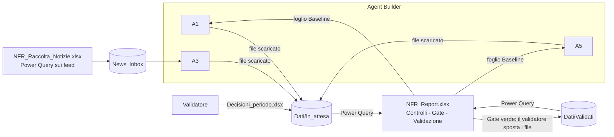

# 7. Piano: semplificare l'orchestrazione ed eliminare Python dall'esercizio

> **In riserva dal 27/09/2026 (D-43, scelta dell'utente).** Python resta il
> motore; l'automazione per l'analista segue il piano
> `10_Piano_automazione_processo.md`, le cui voci di lavoro sono nel TODO del
> pacchetto (AU1-AU6). Questo piano si riprende solo se la Banca vietasse
> Python sul PC. Dal 28/09 Copilot Studio e Power Query risultano disponibili
> (D-44, chiude A-05); le verifiche V1-V7 qui sotto restano valide per il
> giorno in cui servisse.

> **Aggiornamento del 25/09/2026 sera (struttura del workbook 2026-09-25c,
> DECISIONI D-39 e D-40).** Il registro e il report sono ora un solo file
> ridisegnato; le schede dei rischi sono un file a parte, `Schede_<ciclo>.xlsx`,
> con i testi dell'agente **A6**, che si lancia dopo la validazione con un solo
> allegato preparato dallo script (che ne controlla l'output). I nomi dei fogli
> citati qui si leggono cosi': Dashboard -> **Registro** (tabella per rischio,
> controlli di validazione e copertura) e **Quadro** (report); Sintesi ->
> **Quadro**; Trend -> **Storico**; KRI_Correnti e Andamento_KRI ->
> **Indicatori**; Analisi_News -> **Notizie**; Approfondimento e Schede -> file
> delle schede; Leggimi -> **Guida**; il radar a tre cicli della Dashboard non
> c'e' piu' (lo sostituiscono Matrice e Radar_Mosca). Fogli nuovi: **Matrice**,
> **Piano_azioni**, **Dizionario**. Qualunque alternativa architetturale deve
> riprodurre questa struttura del report e il passo delle schede; il resto del
> documento e' l'analisi com'era alla sua data.
>
> **Aggiornamento del 02/10/2026 (D-67, struttura 2026-10-02).** Il foglio
> Validazione e' ora una griglia con una riga per rischio, KRI, azione e
> notizia (celle gialle gia' compilate, non toccata = accettata, Score e Margine
> di Mosca calcolati mentre si scrive); lo storico campo per campo lo scrive lo
> script nel foglio Storico_Validazioni. Se il piano tornasse attivo, il "modulo
> Decisioni" (tabella di 7.2) dovrebbe offrire la stessa griglia.

Data: 24/09/2026. Richiesta: rivedere l'architettura di orchestrazione
sapendo che Agent Builder ora puo' creare file, ed eliminare Python salvo che
per la prima attivazione. Il documento dice cosa e' davvero possibile, la
nuova architettura, dove finisce ogni controllo, **ogni punto di impatto
(file, SharePoint, agenti, documentazione) con l'intervento da fare**, le fasi
con i cancelli, i rischi e le decisioni da prendere.

---

## 7.1 Cosa permette davvero Agent Builder (verificato su Microsoft Learn, 24/09/2026)

| Fatto | Conseguenza per il progetto |
|---|---|
| **Code interpreter** ("Create documents, charts, and code") e' **attivo di default** in Agent Builder; scrive ed esegue Python in una sandbox e accetta in ingresso Word, Excel, PowerPoint, PDF, CSV/TSV, TXT. | L'agente puo' consegnare l'output come **file** (JSON o Excel) invece che come testo da copiare. **Da subito**: oggi la guida dice "Capability: nessuna" ma il toggle e' acceso di default: va spento o deciso esplicitamente, agente per agente. |
| I file generati sono **link di download temporanei**, "available for download during the active session only. Files are not persisted after the session ends". | L'agente **non salva** in SharePoint e **non modifica** un file esistente. Resta un passo umano: scaricare e mettere il file nella cartella giusta. Sparisce solo il copia-incolla in Blocco note (codifica, `.json.txt`). |
| Il codice lo **scrive il modello** a ogni esecuzione ("uses the reasoning model to write and run code"). | Il code interpreter **non e' un controllo deterministico**: non puo' sostituire `controlli_a5.py` ne' il validatore. I controlli devono vivere in uno strumento che esegue sempre la stessa logica. |
| **"Modifica con Copilot"** (ex Agent mode, GA 22/04/2026) modifica **in place** un workbook esistente su OneDrive/SharePoint: fogli, celle, intervalli, formattazione. Ma e' Copilot **dentro Excel**, avviato dall'utente con il file aperto, non l'agente Agent Builder in chat. | Potrebbe sostituire la scrittura COM ("accoda le righe di A1_2026Q4.json"), ma **quali celle cambiare lo decide il modello**: niente gate deterministico prima della scrittura, solo controlli a formula dopo e la cronologia versioni. Da verificare: modello usato (EU Data Boundary), rispetto della protezione dei fogli, affidabilita' su 5 tabelle. |
| Gli allegati caricati in chat finiscono nella cartella OneDrive **"Microsoft Copilot Chat Files"** (persistenti). Non ho trovato un modo documentato di scegliere la cartella di destinazione dei file generati. | Copie di baseline e output si accumulano nel OneDrive personale: da trattare in `06_Governance` (retention, condivisione). La destinazione "a scelta" va provata nel tenant (V1). |
| Gli agenti **Word, Excel, PowerPoint** (installati da Microsoft) salvano in OneDrive, ma usano **solo modelli Anthropic**, "currently excluded from EU Data Boundary". | **Non usarli per i dati del registro** senza un parere della compliance/DPO. Al massimo, dopo quel parere, per il report al comitato (opzione D). |
| Knowledge: "up to **20** knowledge sources" (pagina agg. 19/08/2026); istruzioni sempre 8.000 caratteri. | Il README oggi dice "fino a 100 file": da correggere. Il limite di 8.000 resta il vincolo piu' stretto (A1 e' a 7.988). |

**Quindi**: "Agent Builder scrive file" toglie il copia-incolla, **non** toglie il
bisogno di un posto deterministico dove controllare e consolidare i dati.
Quel posto, senza Python, e' **Excel stesso con Power Query**: fa parte di
Microsoft 365, non si installa niente, legge file da SharePoint, JSON e feed
RSS, e ricalcola sempre allo stesso modo.

---

## 7.2 L'architettura proposta: "file per ciclo + report che controlla"

### Idea in cinque righe

1. Ogni agente consegna il suo output come **file** (`A1_2026Q4.json`,
   `A5_2026Q4.json`, `A3_2026-09-21.json`), con lo stesso schema JSON di oggi.
2. L'analista scarica il file e lo trascina in **`Dati/In_attesa/`** su SharePoint.
3. Il **report Excel** (`NFR_Report.xlsx`, Power Query) legge tutti i file e fa i
   **controlli deterministici** (schema, C1-C9 meccanizzabili, gate di A5,
   regole delle rettifiche). Il foglio **Gate** dice: "pronto da validare" oppure
   l'elenco dei problemi.
4. Il validatore compila il modulo delle decisioni. Quando il Gate e' verde,
   **sposta** i file del periodo in **`Dati/Validati/`**. Da li' li leggono
   Dashboard, radar, trend e la **Baseline** del ciclo dopo.
5. **Nessun file viene mai modificato**: la storia e' l'insieme dei file
   validati, immutabili e versionati da SharePoint. Non ci sono piu' la
   scrittura in un registro vivo, i backup, gli Excel congelati di ogni
   scrittura, ne' i nomi definiti che scivolano.

### Dove finisce ogni pezzo di Python di oggi

| Oggi (Python sul PC dell'analista) | Domani (senza Python) |
|---|---|
| `esegui_ciclo_locale.py trimestrale`: valida, controlla, scrive via COM, ricalcola, verifica, salva, archivia | file in `In_attesa` + **query di controllo e Gate** nel report; la "scrittura" e' lo **spostamento** in `Validati` |
| `settimanale` | come sopra, con il file di A3 |
| `baseline` (estrae JSON e `.txt`) | query **Baseline** del report (foglio): A1 e A5 ricevono in allegato il report o il solo foglio |
| `valida` (controlla decisioni, applica, riscrive le liste) | `Decisioni_<periodo>.xlsx` + query **Controlli_Decisioni**; i valori validati sono **calcolati** (proposta o rettifica), non riscritti |
| `inizializza` | **non serve**: il report parte con `Validati` vuota |
| `dismetti` | una riga nella tabella **Anagrafica** (`Dati/Anagrafica.xlsx`, compilata a mano): Stato = Dismesso, data, motivazione, decisore. Le viste la escludono da sole, senza buchi |
| `raccogli_notizie.py` (+ pypac per il proxy) | **`NFR_Raccolta_Notizie.xlsx`**: Power Query legge `fonti.md` e i feed RSS; il lunedi' "Aggiorna tutto". Excel usa la rete **come il browser**: niente problema di PAC |
| `excel_com.py`, `configurazione.json`, pywin32 | **spariscono** dal PC dell'analista |

Python resta **solo sul PC del manutentore** per: costruire i modelli la prima
volta (e quando cambiano), `componi_prompt.py`, il collaudo. E' la "prima
attivazione" richiesta, piu' la manutenzione straordinaria.

### Perche' conviene (misurato su questa settimana)

Oggi, nella prima installazione reale, i blocchi sono stati **tre, tutti del
Python lato analista**: `pythoncom` installato a meta', feed `europa.eu` in
timeout per il proxy PAC, `RPC_E_DISCONNECTED` di Excel via COM. Nella nuova
architettura nessuno dei tre puo' succedere.

### Onesta' sui passi manuali

I passi **non diminuiscono di molto**, ma diventano **passi da utente Office**:
niente Prompt dei comandi, Blocco note o codifica UTF-8.

| Ciclo trimestrale | Oggi | Domani |
|---|---|---|
| Preparare l'input di A1 | `baseline` + copiare `.txt` in Kernel | aprire il report, "Aggiorna tutto" |
| Output di A1 e A5 | copia-incolla in Blocco note, salva con nome e codifica | scaricare 2 file, trascinarli in `In_attesa` |
| Controlli e scrittura | comando `trimestrale` | "Aggiorna tutto", leggere il foglio Gate |
| Validazione | foglio Validazione + comando `valida` | modulo Decisioni + "Aggiorna tutto" + spostare i file in `Validati` |
| Prerequisiti sul PC | Python, pywin32, pypac, `configurazione.json`, cartelle sincronizzate | Excel desktop (gia' presente) |

---

## 7.3 Governance: dove va ogni controllo

Principio che **non cambia**: nessun dato entra nello storico senza passare dai
controlli deterministici e da una persona. Cambia solo **dove** gira il
controllo (da Python a Power Query) e **cosa** e' la scrittura (da scrittura
COM a spostamento del file).

| Controllo | Oggi | Domani | Deterministico |
|---|---|---|---|
| Formato dell'output (schema) | `valida_output.py` | funzione generica `fxValida` in M, che applica la tabella **Regole** generata dagli schemi JSON (stessa idea del validatore generico: nessuna regola ricopiata a mano) | si' |
| C1, C2, C3 (date, frasi generiche, massimo un punto), C5, C7, C9 | `controlli_a5.py` | query `Controlli_C1` ... `Controlli_C9`, unite in `Controlli` (una riga per rilievo, come `Esito_controlli` di oggi) | si' |
| C6, C8 (euristiche) | `controlli_a5.py` | stesse euristiche in M (Osservazione; persona come owner = Bloccante) | si' (euristica) |
| C4 plausibilita' | solo A5 | solo A5 (invariato) | no, per disegno |
| Esito di A5 dello stesso ciclo, senza rischi estranei | `trimestrale` | query `Gate` | si' |
| Codici fonte ammessi | `settimanale` + `fonti.py` | join con `fonti.md` letto da Power Query | si' |
| Copertura del ciclo (tutti i rischi valutati) | verifica post-scrittura | query `Gate` (anti-join con Anagrafica) | si' |
| Il ciclo dopo e' bloccato se il precedente non e' validato | `trimestrale` | la query `Baseline` scrive "BASELINE BLOCCATA: ciclo X non validato" e A1 e' istruito a fermarsi. **Doppia barriera**: anche il Gate del ciclo dopo lo rifiuta | si' |
| Regole delle rettifiche (1-5, massimo un punto, soglie, owner, vocabolari) | `controlla_valore` | query `Controlli_Decisioni` | si' |
| "Tutte o nessuna" | `valida` | un periodo conta come validato solo se `Controlli_Decisioni` e' vuota **e** i file sono in `Validati`; altrimenti le viste usano il ciclo prima | si' |
| Variazioni coerenti dopo una rettifica | `valida` le riscrive | **calcolate** come differenza fra i valori validati di due cicli; quelle dichiarate da A1 restano solo come proposta confrontata (C2) | si', piu' semplice di oggi |
| Storico non riscritto | tabelle solo in coda, backup | file immutabili, `Validati` in sola lettura tranne che per il validatore, cronologia versioni SharePoint | per costruzione |
| Chi ha validato e quando | colonne scritte da `valida` | colonne `Validato_Da` / `Data` nel modulo Decisioni + metadati SharePoint del file | si' |
| Errori di formula, formule mancanti | verifiche post-scrittura | non servono piu' (nessuna scrittura dentro formule); al loro posto il foglio **Stato_query**, con gli errori di aggiornamento | n/a |

**Nota sull'obiettivo futuro** (dare agli agenti il permesso di scrivere): qui
l'agente scrive gia' **il suo file**, ma mai nello storico. Se un giorno Agent
Builder potra' salvare direttamente in SharePoint, il file arrivera' in
`In_attesa` da solo e il **gate restera' identico**. L'architettura e' gia'
predisposta.

---

## 7.4 I flussi, passo per passo (per la nuova guida)

**Settimanale** (lunedi')
1. Aprire `NFR_Raccolta_Notizie.xlsx` (Excel desktop), "Aggiorna tutto",
   salvare. Le notizie degli ultimi 7 giorni finiscono in tabella; in testa, le
   fonti irraggiungibili.
2. A3 (knowledge: `News_Inbox`, `Analisi_Interne`, report per l'anagrafica, i
   quattro siti): "Esegui l'aggiornamento settimanale" → scaricare
   `A3_<lunedi'>.json` → trascinarlo in `Dati/In_attesa/`.
3. `NFR_Report.xlsx`, "Aggiorna tutto" → foglio Gate: verde, oppure l'elenco
   dei problemi (es. codice fonte non ammesso) da rimandare ad A3.
4. Facoltativo: validazione delle notizie (vedi sotto), poi spostare in `Validati`.

**Trimestrale**
1. Report, "Aggiorna tutto" → foglio Baseline pronto (oppure BLOCCATA).
2. A1 con il report allegato: "Esegui il ciclo" → scaricare `A1_<ciclo>.json`
   → `In_attesa`.
3. A5 con `A1_<ciclo>.json` e il report allegati → scaricare `A5_<ciclo>.json`
   → `In_attesa`.
4. Report, "Aggiorna tutto" → Gate. Se rosso: nuovo run di A1 **e** di A5, poi
   sostituire i file in `In_attesa`. I vecchi vanno in `Dati/Scartati/`, per la
   traccia dei tentativi.

**Validazione**
1. Dal report, foglio **Da_validare** (una riga per proposta), incollare i
   valori nel modello `Modello_Decisioni.xlsx` e salvarlo come
   `Decisioni_<periodo>.xlsx` in `In_attesa`.
2. Compilare Decisione, Valore_Validato, Motivazione, Validato_Da; "Aggiorna
   tutto" sul report → `Controlli_Decisioni`.
3. Se vuoto: spostare **tutti** i file del periodo in `Validati`. Dashboard,
   radar e Baseline si aggiornano. Per il comitato: salvare una copia PDF del
   report (o, dopo il parere DPO, il report PowerPoint).

**Dismissione**: una riga in `Anagrafica.xlsx` (Stato Dismesso, motivazione,
decisore, data). Non si cancella niente.

---

## 7.5 Punti di impatto e interventi (tutti)

Legenda: **Mantieni** (nessun intervento), **Modifica** (intervento mirato),
**Riscrivi** (stesso scopo, contenuto nuovo), **Elimina**, **Nuovo**, **Sposta**
(resta, ma solo per il manutentore).

### A. Kernel (`01_Kernel`)

| File | Azione | Intervento |
|---|---|---|
| `tassonomia_nfr.md` | Mantieni | Nessuno. Power Query ne legge i codici per il controllo degli event type (stessa fonte unica). |
| `rubrica_scoring.md` | Mantieni | Nessuno sul metodo. Sezione 8 (Mosca): il calcolo passa da formule a query, il metodo resta uguale. |
| `fonti.md` | Modifica | Formato invariato. Power Query lo legge direttamente (titoli `### FNT-nn`, righe `- chiave: valore`). Va aggiunta una nota in testa: "lo legge anche NFR_Raccolta_Notizie.xlsx". Le regole `escludi` e `max_voci` vanno ricodificate in M. |
| `schema_output_A1/A3/A5.json` | Mantieni | Il contratto non cambia: **i JSON prodotti oggi restano validi** (anche l'A3 del 21/09). Da questi schemi si genera la tabella **Regole** del validatore in M. |
| `schema_output_A1_DOCUMENTATO.md` | Modifica | La sezione "baseline" descrive il foglio Baseline del report, non piu' il JSON di Python. |
| `mappatura_campi.json` | Riscrivi | Da "campo → colonna scritta via COM" a "campo → colonna delle query". I campi derivati (KRI_ID assegnati, ID_Azione, Owner da anagrafica) diventano passi di query. La sezione `liste_sharepoint` va eliminata (niente Power Automate). |

### B. Agenti (`02_Agenti`) e configurazione in Agent Builder

| Punto | Azione | Intervento |
|---|---|---|
| `modelli/A1.md` | Modifica | Input: "il report allegato, foglio Baseline; se dice BLOCCATA rispondi solo ...". Output: "oltre al JSON, crea con il code interpreter il file scaricabile `A1_<ciclo>.json`, contenuto identico". **Vincolo**: A1 e' a 7.988/8.000 caratteri, servono ~250 caratteri liberi (candidati: accorciare lo scheletro dell'output, che applica gia' il validatore). |
| `modelli/A3.md` | Modifica | Input: la tabella di `NFR_Raccolta_Notizie.xlsx` al posto di `Raccolta_*.txt`; anagrafica dal report. Output: file `A3_<lunedi'>.json`. |
| `modelli/A4.md` | Modifica | Fonte della valutazione vigente: foglio Baseline del report. Nessun file in uscita (A4 da' pareri). |
| `modelli/A5.md` | Modifica | Input: `A1_<ciclo>.json` + report (solo foglio Baseline). Output: file `A5_<ciclo>.json`. Resta **"non cercare"**: il code interpreter serve solo a scrivere il file, e va detto esplicitamente. |
| Prompt generati `02_Agenti/*.md` | Rigenera | `componi_prompt.py` dopo le modifiche; ricaricarli per intero in Agent Builder. |
| `componi_prompt.py` | Sposta (manutentore) | Nessun cambio di logica. |
| `COMMENTATI/*.md` | Modifica | Il perche' delle nuove frasi (file in uscita, baseline dal report, code interpreter solo per il file). |
| **Agent Builder: capability** | Modifica | Code interpreter **acceso** per A1, A3, A5 (solo per il file in uscita); **spento** per A4. Image generator spento. **Da fare comunque oggi**: il toggle e' acceso di default, verificarlo sui quattro agenti gia' creati. |
| **Agent Builder: knowledge** | Modifica | A3 e A4: aggiungere `Report/NFR_Report.xlsx` (anagrafica, baseline), togliere `Kernel/Baseline_corrente.txt`. A1: invariata (il report arriva in allegato). A5: nessuna (invariato). |
| **Prompt schedulato di A3** | Modifica | Invariato nel testo; verificare dove arriva la risposta e che il link al file sia scaricabile dalla notifica. |

### C. Workbook e Power Query (`03_Excel`)

| Punto | Azione | Intervento |
|---|---|---|
| `NFR_Dashboard_Template.xlsx` (registro vivo con 3.154 formule e 113 nomi) | Elimina | Sostituito da `NFR_Report.xlsx`, che **legge soltanto**. |
| `NFR_Report.xlsx` | Nuovo | Fogli (aggiornati alla struttura D-39): Guida, Gate, Stato_query, Da_validare, Quadro, Classifica, Radar_Mosca, Matrice, Delta, Metodologia, Registro, Storico, Indicatori, Notizie, Piano_azioni, Dizionario, Baseline, Parametri; le schede dei rischi restano un file a parte (A6, D-40). Le viste sono **tabelle di query** e i grafici poggiano su tabelle, quindi si allargano da soli: niente OFFSET, nomi assoluti, riga segnaposto o capienze fisse. |
| `query/*.pq` | Nuovo | Il codice M come **file di testo versionati** (fonte unica, leggibile in un diff): `Parametri`, `Origine` (cartella SharePoint o locale per il collaudo), `fxLeggiPayload`, `fxValida`, `Regole`, `Proposte_*`, `Controlli_C1..C9`, `Controlli_Decisioni`, `Gate`, `Validati_*`, `Baseline`, viste. |
| `NFR_Raccolta_Notizie.xlsx` | Nuovo | Query su `fonti.md` e sui feed RSS, finestra di 7 giorni, `escludi`, `max_voci`, doppioni, fonti irraggiungibili in testa. **File separato dal report**, per non mescolare fonti web e SharePoint (vedi il rischio R4, "Formula.Firewall"). |
| `Modello_Decisioni.xlsx`, `Anagrafica.xlsx` | Nuovo | Modelli semplici, con convalide a elenco (Decisione, Stato). Senza formule complesse. |
| `genera_dashboard.py` | Riscrivi (manutentore) | Costruisce i quattro file: openpyxl per fogli, tabelle e grafici; COM (`Workbook.Queries.Add`) per installare le query dai file `.pq`. E' il punto tecnico piu' rischioso: **spike T1**. |
| `costruzione_manuale_template.md` | Riscrivi | Come ricostruire il report a mano incollando le query `.pq` nell'editor di Power Query (utile se Python non e' disponibile nemmeno al manutentore). |

### D. SharePoint (`04_SharePoint`)

| Punto | Azione | Intervento |
|---|---|---|
| `struttura_e_liste.md` | Riscrivi | Library: `Kernel`, `Analisi_Interne`, `News_Inbox` (con `NFR_Raccolta_Notizie.xlsx` e `Manuali/`), **`Dati`** (`In_attesa/`, `Validati/`, `Scartati/`, `Anagrafica.xlsx`), **`Report`** (`NFR_Report.xlsx`, copie PDF per ciclo). `Report_Trimestrali`, `Report_Settimanali` e `Archivio_Cicli` confluiscono in `Dati` e `Report`. Via la sezione "Liste". |
| Permessi | Modifica | `Validati`: scrittura solo al validatore (e' lo storico). `In_attesa`: analisti. `Kernel`: manutentore. Il report: sola lettura per chi consulta. |
| **Sito gia' creato nel tenant** (questa settimana) | Modifica | Creare `Dati` con le tre cartelle e `Report`. Le library vecchie restano finche' non finisce il parallelo, poi si archiviano. Non c'e' niente da migrare: il registro inizializzato e' vuoto. |

### E. Script di campo (`07_Senza_Studio`)

| File | Azione | Intervento |
|---|---|---|
| `esegui_ciclo_locale.py` | Elimina (dopo il parallelo) | Logica migrata come nella tabella di 7.2. Fino al go-live resta come **riferimento** per il collaudo. |
| `raccogli_notizie.py` | Elimina | Sostituito da `NFR_Raccolta_Notizie.xlsx`. Togliere l'attivita' dell'Utilita' di pianificazione, se creata. |
| `excel_com.py` | Sposta (manutentore) | Usato solo per costruire i modelli e per il collaudo. |
| `controlli_a5.py` | Sposta, poi elimina | Durante la migrazione e' l'**oracolo** del collaudo (stessi input, stessi rilievi delle query M). Dopo, risultati attesi fissi e il file si elimina, per non avere due copie delle regole. |
| `valida_output.py` | Sposta (manutentore) | Genera la tabella Regole dagli schemi; resta l'oracolo del validatore M. |
| `fonti.py` | Sposta (manutentore) | Lo usa `componi_prompt.py`. |
| `configurazione_esempio.json` | Elimina | Al suo posto una cella "Cartella SharePoint" nel foglio Parametri del report. |
| `README_variante_locale.md` | Riscrivi | Diventa il README della **soluzione unica**: agenti (capability e knowledge nuove, limite a 20 fonti), modelli Excel, niente Python per l'analista. |

### F. Governance, workflow, deploy

| File | Azione | Intervento |
|---|---|---|
| `06_Governance/controlli_e_model_risk.md` | Modifica | Tabella dei controlli (implementazione in M, gate = spostamento del file). Evidenze per ciclo (file in `Validati`, PDF del report, decisioni). Nuovi rischi: code interpreter non deterministico (solo per scrivere il file), file temporanei, gate aggirabile spostando a mano un file rosso (mitigazione: permessi di `Validati` e riga "promosso con Gate rosso" nel report). Nota EU Data Boundary per gli agenti Office. |
| `05_Workflow/workflow.md` (variante Copilot Studio + Power Automate) | **Decisione** | L'ambiente e' solo M365. Proposta: archiviarla come "non mantenuta", fuori dal pacchetto. Tenerla vuol dire aggiornarla anche lei. |
| `08_Deploy/Piano_deploy.md` | Riscrivi | Fase 2 senza Python (resta Excel desktop). Fase 3 con le library nuove. Fase 4: al posto di `inizializza`, Parametri e Anagrafica. Fase 5: raccolta con Excel. Fase 6: toggle del code interpreter. Contingenze sugli errori di Power Query. **G0**: aggiungere le verifiche V1-V7 (7.7). |

### G. Documentazione per chi usa e chi mantiene (pacchetto)

| File | Azione | Intervento |
|---|---|---|
| `00_GUIDA_PASSO_PASSO.md` | Riscrivi | Sezioni 0, 1, 2, 3, 3-bis e 7 con i flussi del 7.4. Nuova tabella degli errori (errori di aggiornamento delle query, Gate rosso, file con nome sbagliato, due file per lo stesso periodo). Via le righe su pythoncom, pypac, proxy, COM e `configurazione.json`. |
| `00_LEGGIMI.md` | Riscrivi | "Il sistema in una pagina" (A2 diventa report + gate), indice dei file, "Dove vive ogni regola" (controlli → `03_Excel/query/`), requisiti (analista: nessun Python). |
| `TODO_possibili_sviluppi.md` | Modifica | Chiudere G4 (migrazione del registro: non esiste piu'). Aggiungere il salvataggio diretto in SharePoint quando Agent Builder lo permettera'. |

### H. Collaudo (`99_Collaudo`)

| File | Azione | Intervento |
|---|---|---|
| `dati/*.json` | Mantieni | Il contratto non cambia: **tutti i payload di prova si riusano**. |
| `run_catena.py` | Riscrivi | Copia i payload in una cartella locale, punta il parametro Origine del report su quella cartella, "Aggiorna tutto" via COM, legge Gate, Controlli, Baseline e viste, confronta con i risultati attesi. Stessi scenari di oggi: due cicli, rettifiche, A5 di un altro ciclo, primo uso, dismissione, notizie. |
| `test_controlli.py` | Riscrivi | Stessi casi, ma verifica le query M contro l'oracolo Python (durante la migrazione) e poi contro risultati attesi fissi. |
| `test_mappatura.py` | Modifica | Mappa ↔ colonne delle query e dei modelli. |
| `test_fonti.py` | Modifica | La lettura di `fonti.md` in M deve coincidere con `fonti.py`. Raccolta su feed finti locali. |
| `verifica_riferimenti.py` | Modifica | Non controlla piu' i comandi dello script: controlla che fogli, query e file citati nella guida esistano davvero. |
| `confronta.py` | Mantieni | Doppio run di A1, invariato. |
| `LEGGIMI_collaudo.md`, `esegui_collaudo.py` | Modifica | Nuovo elenco dei test. |

### I. Fuori dal pacchetto

| Punto | Azione | Intervento |
|---|---|---|
| `PROMPT_MASTER_rigenerazione.md` | Riscrivi (molte sezioni) | Scelte dell'utente ("nessun Python in esercizio"), vincoli di piattaforma (7.1), "Lo script di campo" → "Il report e le query", workbook, SharePoint, collaudo. **Trappole**: quelle di COM e dei nomi definiti diventano storiche; aggiungere le nuove (Formula.Firewall, livelli di privacy, file temporanei del code interpreter). |
| `HANDOFF_stato_e_prossimi_passi.md` | Modifica | Decisione presa, puntatore a questo piano, stato del parallelo. |
| `Mail_piano_deploy.md` | Gia' tolta (24/09) | L'utente l'ha eliminata. Se serve una mail, va rigenerata dal Piano_deploy aggiornato. |
| `Demo_W1_W2/` | Riscrivi | Rifare la demo con il nuovo flusso (due cicli, due settimane, validazioni) a partire dagli stessi payload. |
| `Analisi_Architettura/00_LEGGIMI_analisi.md`, `04_Confronto_e_raccomandazione.md` | Modifica | Indice aggiornato. In C, il contro "resta il PC con Python" cade: C+D diventa senza Python. |
| Pacchetto zip distribuito | Rigenera | Un nuovo zip a fine migrazione. |
| **Installazione sul PC dell'analista** (OneDrive Intesa Sanpaolo) | Modifica | Niente da installare. Python, pywin32 e pypac possono restare (inutilizzati) o essere rimossi. `configurazione.json` non serve piu'. |

---

## 7.6 Fasi, con verifiche e cancelli

| Fase | Contenuto | Verifica | Cancello (chi dice si') | Durata |
|---|---|---|---|---|
| **S0 — Verifiche nel tenant e spike** | V1-V7 (7.7). **T1**: costruire via COM un report con 3 query da file `.pq` e un grafico su una tabella di query. **T2**: una query RSS su 3 feed `europa.eu` da Excel desktop sul PC della Banca. **T3**: giro completo di un modulo Decisioni (incolla valori, compila, aggiorna, controllo). | T1, T2 e T3 riusciti; V1-V7 con esito scritto | Responsabile + manutentore: **si procede o si resta sull'attuale** | 3-5 giorni |
| **S1 — Dati e controlli** | `Origine`, `fxLeggiPayload`, `fxValida` + Regole, Proposte, C1-C9, Gate, Stato_query | Test con i payload esistenti; rilievi identici all'oracolo `controlli_a5.py` | Manutentore | 1,5-2 settimane |
| **S2 — Validazione e storico** | Modello Decisioni, Controlli_Decisioni, Validati, valori validati calcolati, Baseline con blocco, Anagrafica | Scenari di `run_catena` (rettifiche, respinti, blocco, dismissione) | Manutentore + validatore (prova il modulo) | 1 settimana |
| **S3 — Viste e grafici** | Dashboard, Radar_Mosca, Trend, Delta, KRI, Analisi_News su tabelle di query | Immagini esportate e confrontate con le viste attuali sugli stessi dati; Radar_Mosca contro il calcolo indipendente di oggi | Responsabile (le guarda) | 1-1,5 settimane |
| **S4 — Raccolta notizie** | `NFR_Raccolta_Notizie.xlsx` | Due lunedi' di raccolta sul PC della Banca, confrontati con `raccogli_notizie.py` | Analista | 2 giorni + 2 settimane di rodaggio |
| **S5 — Agenti** | Modelli A1/A3/A4/A5, capability, knowledge, file in uscita | Prova di fumo: ogni agente consegna un file scaricabile che passa il Gate | Manutentore | 2-3 giorni |
| **S6 — Documentazione e collaudo** | Tutti gli interventi di 7.5 G, F, I; suite verde | `esegui_collaudo.py` tutto OK; guida seguita da una persona che non l'ha scritta | Responsabile | 1 settimana |
| **S7 — Parallelo** | Il primo ciclo, da registro vuoto, con i due sistemi sugli stessi output degli agenti | Stessi valori validati, stessi rilievi, stessa copertura | Responsabile + model risk: via, eliminare il Python lato analista | un ciclo |

Totale: circa **5-7 settimane** fino al parallelo. **Momento favorevole**: il
sistema non e' ancora in esercizio e il registro e' vuoto, quindi non c'e'
nessuna migrazione di dati. Ogni settimana in esercizio sull'attuale renderebbe
il passaggio piu' costoso.

**Ritorno indietro**: fino a S7 l'attuale resta integro e funzionante (il
contratto JSON e' lo stesso). Si puo' tornare indietro in qualsiasi fase senza
perdere nulla.

---

## 7.7 Da verificare nel tenant prima di S1 (parte del cancello S0)

| # | Verifica | Se l'esito e' negativo |
|---|---|---|
| **V0** | **Superata il 25/09/2026: Power Query e' abilitato sull'Excel aziendale** (conferma dell'utente). Da provare comunque i connettori usati dal piano. **Power Query c'e' ed e' usabile** in Excel desktop della Banca: Dati → Recupera dati → Da file → **Da JSON** e **Da cartella SharePoint**; Da altre origini → **Da Web** (per l'RSS). E' il presupposto dell'intero piano | Vedi 7.10: senza Power Query il piano, cosi' com'e', non regge |
| V1 | Il code interpreter e' disponibile per gli agenti e produce un file `.json` scaricabile, integro (confronto con il testo in chat) | Si resta al copia-incolla, ma senza Python: il JSON si salva in `In_attesa` dal browser (SharePoint → Nuovo → file di testo) |
| V2 | Un allegato `.xlsx` (il report) e' letto per intero da A1 e A5; dimensione massima degli allegati | Un file `Baseline.xlsx` piccolo, ottenuto con "Sposta o copia foglio" |
| V3 | Excel desktop della Banca aggiorna query su SharePoint (account aziendale) e sui feed RSS attraverso il proxy | Per SharePoint: file sincronizzati via OneDrive e cartella locale. Per RSS: resta il canale manuale (`Manuali`) finche' l'IT non apre |
| V4 | Excel per il web aggiorna le query del report (utile a chi consulta) | Aggiornamento solo da desktop, come oggi; chi consulta legge il PDF |
| V5 | Modello usato dal code interpreter dentro gli agenti dichiarativi e perimetro dei dati (EU Data Boundary) | Parere DPO; al limite code interpreter spento e copia-incolla verso SharePoint (V1, piano B) |
| V6 | Stato dell'accesso di default "a tutto cio' che vede Copilot" (Outlook, Teams, web) per gli agenti creati, e come si limita | Documentare il limite nei rischi; permessi SharePoint stretti |
| V7 | Politiche della Banca su Power Query (connettori web, livelli di privacy) | Chiedere l'eccezione per l'elenco dei feed, oppure solo canale manuale |

---

## 7.8 Rischi e contro, detti chiaramente

| # | Rischio | Gravita' | Mitigazione |
|---|---|---|---|
| R1 | **Si butta via codice collaudato** (A2 in Python, 414 verifiche) per rifarlo in M, un linguaggio nuovo per il manutentore | Alta | Oracolo Python durante la migrazione; payload di prova riusati; spike prima di impegnarsi |
| R2 | Le query M sono **meno comode da collaudare** del Python | Media | Collaudo con Excel via COM sul PC del manutentore (come oggi `run_catena`); query piccole, una per controllo |
| R3 | **Gate aggirabile**: un file rosso spostato a mano in `Validati` | Media | Permessi di `Validati` al solo validatore; il report ricontrolla anche `Validati` e mostra "PROMOSSO CON GATE ROSSO" in Dashboard |
| R4 | **Formula.Firewall / livelli di privacy** di Power Query quando si combinano fonti diverse | Media | Raccolta notizie in un file separato; nel report solo fonti SharePoint; livelli di privacy documentati |
| R5 | Il file scaricato non e' identico a quanto l'agente ha scritto in chat (lo produce codice scritto dal modello) | Bassa | Lo schema e i controlli lo verificano comunque. Il testo in chat resta come controprova |
| R6 | L'aggiornamento e' manuale ("Aggiorna tutto"): dimenticarlo mostra dati vecchi | Bassa | Data dell'ultimo aggiornamento in evidenza nel Gate e in Dashboard; aggiornamento all'apertura attivo |
| R7 | Recupero parziale dalla knowledge `.xlsx` (A3, A4) | Media | Per A1 e A5 l'allegato (letto per intero); A3 e A4 usano solo l'anagrafica, piccola |
| R8 | Il limite di 8.000 caratteri di A1 (7.988 oggi) | Media | Accorciare lo scheletro dell'output (lo applica gia' il validatore) prima di aggiungere frasi |

---

## 7.9 Decisioni da prendere

1. **Procedere con S0?** (3-5 giorni; nessun impegno oltre).
2. **Variante Copilot Studio/Power Automate** (`05_Workflow`): archiviarla o mantenerla.
3. **Report al comitato**: PDF del report (subito) o PowerPoint con gli agenti
   Office (solo dopo il parere DPO su Anthropic ed EU Data Boundary).
4. **Validazione delle notizie settimanali**: obbligatoria o facoltativa (oggi facoltativa).
5. **Chi puo' spostare i file in `Validati`**: solo il validatore (consigliato) o anche gli analisti.

## 7.10 Se Power Query non e' disponibile (esito negativo di V0)

Il piano poggia su Power Query per tre cose: leggere i file, fare i controlli e
consolidare lo storico. Senza Power Query resta vero cio' che dice il 7.1:
l'agente consegna un file, ma qualcosa di deterministico deve controllarlo
prima che entri nello storico. Le strade senza Python installato:

| Opzione | Come | Gate deterministico | Contro |
|---|---|---|---|
| **A. Office Scripts** (documento 02) | JSON incollato in un foglio, pulsante "Scrivi ciclo": lo script valida, controlla e scrive nelle tabelle | si' | TypeScript (scartato dall'utente); collaudo automatico quasi perso; l'amministratore puo' disattivarli; niente RSS |
| **P. Python in Excel** (`=PY()`) | JSON incollato in una cella; celle Python (eseguite nel cloud Microsoft, niente da installare) riusano quasi alla lettera `valida_output.py` e `controlli_a5.py`; l'esito e' una tabella | si' (codice nostro, non scritto dal modello) | Da verificare disponibilita' e licenza nel tenant; dati elaborati nel cloud Microsoft (parere DPO); non scrive nelle tabelle: l'accodamento resta un incolla valori |
| **A-bis. Solo formule** (documento 02) | Righe incollate, formule che segnalano gli errori | no: controllo visivo | Solo per un pilota |
| **Restare sull'attuale** (Python installato) | Come oggi. Unico miglioramento: l'agente consegna il file `.json` scaricabile al posto del copia-incolla in Blocco note | si', il piu' collaudato | Resta il PC con Python. I problemi di questa settimana (pythoncom, proxy, COM) erano di prima installazione e sono in gran parte risolti |

**Raccomandazione se V0 e' negativa**: restare sull'attuale con il file
scaricabile, e verificare Python in Excel (opzione P). Se e' abilitato, e' il
modo meno costoso per togliere l'installazione senza riscrivere i controlli in
un altro linguaggio. Office Scripts solo se l'IT li conferma attivi e la Banca
accetta di perdere il collaudo automatico.

## 7.11 Copilot Studio: cosa costa davvero (Microsoft Learn, "Billing rates", agg. 14/09/2026)

Per un utente con licenza Microsoft 365 Copilot che usa l'agente in Copilot
Chat, Teams o SharePoint **con la propria identita'**, sono "No charge" (entro
limiti di fair use): risposte, grounding sul tenant, **azioni dell'agente**
(strumenti e connettori), strumenti AI e **azioni degli agent flow**.

L'eccezione che conta: gli agent flow sono gratuiti **solo** se partono con il
trigger **"When an agent calls the flow"**, cioe' quando e' l'agente a lanciarli
durante una conversazione con un utente licenziato. Gli agent flow con **altri
trigger** (pianificati, a evento) consumano Copilot Credits alla tariffa
standard (13 crediti ogni 100 azioni). Anche un agente autonomo a evento consuma
crediti.

Per questo progetto:
- **settimanale, trimestrale, validazione avviati dall'analista in chat**
  ("Esegui l'aggiornamento settimanale" → l'agente chiama il flow che salva il
  file in SharePoint, controlla, accoda): **nessun credito**;
- **solo le esecuzioni pianificate** (es. A3 il lunedi' alle 7 senza nessuno in
  chat) consumano crediti. Si evitano lanciandole a mano, o con un credito
  minimo o pay-as-you-go per quelle poche;
- i **cloud flow di Power Automate** (non gli agent flow) usano la licenza di
  Power Automate, non i crediti: con i connettori standard (SharePoint, Excel
  Online) di solito rientrano nei diritti inclusi in Microsoft 365. Da
  verificare con l'IT, visto che finora Power Automate era escluso.

Da confermare con l'IT: che l'agente operi con l'identita' dell'utente
(condizione della gratuita'), i limiti di fair use, e che senza un pacchetto di
crediti nel tenant le esecuzioni pianificate siano semplicemente bloccate (non
fatturate a sorpresa).

## Fonti (consultate il 24/09/2026)

- Microsoft Learn, [Code Interpreter Capability for Declarative Agents](https://learn.microsoft.com/en-us/microsoft-365/copilot/extensibility/code-interpreter), agg. 29/07/2026: attivo di default in Agent Builder; file scaricabili "for the active session only", non persistiti; codice scritto dal modello.
- Microsoft Learn, [Build Agents with Agent Builder](https://learn.microsoft.com/en-us/microsoft-365/copilot/extensibility/agent-builder-build-agents), agg. 19/08/2026: capability disponibili, 8.000 caratteri, fino a 20 knowledge source.
- Microsoft Learn, [Create files with Word, Excel, and PowerPoint Agents](https://learn.microsoft.com/en-us/microsoft-365/copilot/wordexcelppt-agents), agg. 28/08/2026: file salvati in OneDrive; solo modelli Anthropic; esclusi dall'EU Data Boundary.
- Documenti 02 (alternativa C) e 04 (raccomandazione C + D) di questa cartella.
