# Demo W1 e W2 — cosa produce ogni agente, e cosa decide il validatore

Sequenza eseguita la prima volta il 23/09/2026 e **rilanciata l'08/10/2026 sera** sul pacchetto con la struttura
2026-10-09. Novita' rispetto al rilancio precedente: il **registro unico** (D-79), al posto della lista di
osservazione della D-73.
- Un solo registro di rischi `NFR-nn`, con la stessa scala. I primi sono **nel radar** di Mosca: Prossimita e
  Probabilita almeno 2, fino a 15 posti, piu' le eccezioni. Gli altri sono **in osservazione**: niente KRI ne' azioni,
  con l'orizzonte e il segnale che li porterebbe nel radar.
- Nella demo NFR-16 (vertenze e carenza di tecnici IT) nasce in osservazione nel 2026Q3, la settimana dopo A3 vede il
  suo segnale, e nel 2026Q4 **entra nel radar** con KRI e azioni.

Restano le novita' dei giorni prima:
- ciclo straordinario fatto da A8 con l'analisi dell'evento (D-75, D-77);
- riapertura della validazione (D-76);
- tassonomia interna della Banca, nove categorie (D-74);
- knowledge di A7 (D-72);
- A5 facoltativo e segnalazioni in validazione (D-71);
- allegato di A1 e precontrollo con l'impronta (D-69, D-70);
- schede con il perche' di ogni numero (D-68);
- validazione in una griglia (D-67);
- livello di allerta e due KRI per rischio (D-63..D-65);
- scoring semplificato (D-49..D-62);
- registro e report in un solo file, schede a parte (D-39, D-40).

Si rilancia con `python esegui_demo.py` (circa 15 minuti).

| # | Passo | Periodo | Esito |
|---|---|---|---|
| 0 | W0 raccolta notizie, **reale** (rete vera, feed di oggi) | settimana del 05/10/2026 | 135 notizie da 13 delle 18 fonti interrogate; 3 non raggiungibili da questa rete |
| 1 | Precontrollo e W1 con un output di A1 difettoso | 2026Q3 | **fermato** dal precontrollo (2 punti da correggere: un KRI con l'identificativo di un altro rischio), poi anche da `trimestrale`, con lo stesso messaggio per A1; registro intatto |
| 2 | Precontrollo e W1 con l'output corretto | 2026Q3 | precontrollo: 0 da correggere, 14 da verificare; scritto: **12 rischi nel radar, 4 in osservazione** (NFR-16 nuovo, piu' i tre del template) |
| 3 | W1 del trimestre dopo, **prima** di validare | 2026Q4 | **fermato**: 53 righe ancora da validare |
| 4 | Validazione nella griglia | 2026Q3 | 53 righe: 48 accettate, 4 rettificate (5 valori), 1 respinta |
| 5 | W2 + validazione delle notizie | settimana del 12/10/2026 | 5 notizie, 1 segnale rettificato; lo sciopero va su **NFR-16, in osservazione**, con un flag di A3 |
| 6 | W3 su richiesta (A4) | 12/10/2026 | parere su una notizia |
| 7 | Precontrollo, W1 **senza A5** + validazione | 2026Q4 | nessun rilievo; **NFR-16 entra nel radar** (13 rischi), 3 restano in osservazione; 55 righe accettate senza toccarle |
| 8 | **Riapertura** della validazione per NFR-02 | 2026Q4 | 7 righe in griglia; Probabilita da 2 a 4 (nessun limite in riapertura) e un KRI rettificato |
| 9 | Schede dei rischi | 2026Q4 | `Schede_2026Q4.xlsx`, 13 schede (i rischi del radar), senza A6 |
| 10 | Report al comitato (`report`), correzione manuale e report rigenerato | 2026Q4 | PDF di 13 pagine con la pagina Fenomeni (i rischi in osservazione); dopo la correzione del presidio di NFR-02, 16 pagine con Registro e Parametri |
| 11 | Settimana con la **proposta di ciclo straordinario** di A3 | settimana del 16/11/2026 | "PROPOSTA DI CICLO STRAORDINARIO di A3 per NFR-01" a video e nel foglio Notizie |
| 12 | **Ciclo straordinario** deciso e fatto da **A8** | 2026Q4-S1 | NFR-01 rivalutato (Probabilita da 4 a 5), gli altri 12 rischi del radar e i 3 in osservazione riportati gia' validati; validato |

> **Chi ha fatto cosa.** Gli output degli agenti (A1, A3, A4, A5, A8, cartella `1_Input_agenti`) e le decisioni del
> validatore (`Decisioni_validatore_*.json`) li ho scritti io, Claude, seguendo prompt e regole: sono **simulati**. Lo
> script, i controlli e l'Excel girano **davvero**. La raccolta W0 ha scaricato davvero i feed dell'08/10/2026. Le
> notizie delle settimane del 12/10 e del 16/11 restano simulate: la demo si svolge nel futuro (2026Q3-2027Q1).
> L'output di **A6 non e' simulato**: le schede escono con i testi di A1 dal registro; i controlli su A6 li prova il
> collaudo (`run_catena.py`, passo 2c).

---

## Il registro di partenza: 12 rischi nel radar, 3 in osservazione

Il template ha 12 rischi di esempio su tre cicli (2025Q4-2026Q2), classificati con le nove categorie interne (D-74),
tutti **nel radar**. In piu' tre rischi **in osservazione** (le tre voci della vecchia lista, rivalutate con la
rubrica), fuori dal radar perche' la Prossimita o la Probabilita sono sotto la soglia 2:

| Rischio | Imp · Prob · Pross · Vel | Score | Perche' fuori dal radar |
|---|---|---|---|
| NFR-14 Interruzione di cavi sottomarini per una crisi geopolitica | 4 · 2 · 1 · 4 | 2,90 | Prossimita 1 sotto la soglia 2 |
| NFR-13 Rottura della crittografia dei pagamenti con il calcolo quantistico | 5 · 1 · 1 · — | 2,75 | Prossimita e Probabilita sotto la soglia |
| NFR-15 Responsabilita' per decisioni di agenti di IA autonomi | 3 · 1 · 2 · — | 2,13 | Probabilita 1 sotto la soglia 2 |

Nessun rischio su **9.11 Employer**: e' l'area che la catena porta prima in osservazione e poi nel radar.

NFR-01, 02, 07 e 09 sono temi all'attenzione del supervisore (◆). Ogni rischio del radar ha due KRI, uno di
esposizione e uno di evoluzione. NFR-11 ha 3 anni di adeguamento strutturale (sistemi di pagamento legacy).
Presidio dei controlli (giudizio della Banca, fuori dallo score): Adeguato NFR-05; Parziale NFR-01, 07, 12; Assente
NFR-06, 11; gli altri Non verificato. NFR-10 ha la Velocity non valutata e NFR-10-K1 non ha soglie.

---

## W0 — raccolta notizie (reale)

`raccogli_notizie.py --anche-da-validare` ha scritto `News_Inbox/2026-10-05/Raccolta_2026-10-08.txt`, una voce per
notizia con il **codice fonte** che A3 riporta:

```text
Finestra: dal 2026-10-01 al 2026-10-08. Fonti interrogate: 18; con notizie: 13; notizie: 135.
```

Tre fonti (FSB, NCSC del Regno Unito, Europol) non erano raggiungibili da questa rete in quel momento: la raccolta lo
dice e prosegue.

---

## W1 — ciclo 2026Q3

**A1** (`A1_2026Q3.json`): i 12 rischi del radar e un rischio nuovo. Fra i rischi del radar cambia un solo valore,
la Prossimita di NFR-03, da 3 a 4, dopo una sanzione a una banca comparabile: lo script lo scrive "Variato" e aggiunge
"da 3 a 4". Il resto dell'output:
- 15 azioni e due KRI per rischio del radar, con il tipo; NFR-02-K2 sostituito da un KRI nuovo dello stesso tipo,
  NFR-02-K3;
- un **rischio nuovo, NFR-16 "Vertenze e carenza di tecnici nei ruoli IT critici"** (9.11). Valori: Impatto 3,
  Probabilita 2, Prossimita 1, Velocity non valutata, quindi score 2,19. Ha l'orizzonte (5 anni) e il segnale di
  avvicinamento ("uno sciopero di settore che coinvolga il personale IT..."), senza KRI ne' azioni;
- i tre rischi in osservazione del template non li riscrive: nessuna evidenza nuova.

**A5**: Approvato, con un'osservazione C5 su NFR-06.

**Tentativo con un A1 difettoso**: un KRI di NFR-01 porta l'identificativo di NFR-02 (difetto di integrita') e NFR-03
ha un'evidenza generica (regola di metodo). Il **precontrollo** (pochi secondi, senza Excel) lo ferma per il primo e
scrive il messaggio da incollare nella chat di A1:

```
Precontrollo dell'output di A1 (2026Q3): 2 punti da correggere, 16 da verificare.
Impronta dell'output di A1: a31c229d6da1
Da correggere (fermerebbero il ciclo):
1. NFR-01 · C9: KRI NFR-02-K1 appartiene a un altro rischio.
2. ciclo · C9: kri_id NFR-02-K1 usato piu' di una volta.
```

Lanciato comunque, anche `trimestrale` si ferma, solo per il difetto di integrita', e riscrive lo stesso messaggio.
L'evidenza generica da sola non avrebbe fermato il ciclo (D-71): sarebbe arrivata al validatore come segnalazione da
motivare.

**Con l'A1 corretto**: il precontrollo dice `0 punti da correggere, 14 da verificare` (impronta `c18315d71dbc`), poi:

```
Ciclo 2026Q3 scritto: 12/12 rischi, zero errori di formula.
KRI: 25 righe di storico per il ciclo; usciti di vigore: ['NFR-02-K2'].
Registro unico (D-79): nel radar 12 rischi su 15 posti; in osservazione 4; entrati nel radar nessuno; usciti nessuno.
```

NFR-16 resta in osservazione con il motivo calcolato "Prossimita 1 sotto la soglia 2". I tre rischi in osservazione
del template sono **riportati** com'erano, gia' validati, con il loro periodo di valutazione.

## Il ciclo dopo non parte senza validazione

```
FERMATO — il workbook non e' stato modificato.
Il ciclo precedente 2026Q3 non e' ancora validato: 53 righe da validare nel foglio Validazione.
```

53 = 13 rischi scritti da A1 (anche NFR-16, in osservazione) + 25 KRI + 15 azioni: una riga della griglia per
oggetto. Accanto a ogni rischio la griglia mostra lo **stato calcolato con il motivo** e la **decisione sullo stato**
(Automatico, Radar, Osservazione).

## Validazione del 2026Q3

Il validatore (Comitato Rischi) cambia nella griglia sei celle, con la Motivazione, e non tocca le altre righe, che
valgono come accettate. La griglia compilata, prima di `valida`, e' in
[Grafici/Validazione_2026Q3.pdf](Grafici/Validazione_2026Q3.pdf).

| Oggetto | Campo | Proposta dell'agente | Decisione | Valore validato | Motivazione |
|---|---|---|---|---|---|
| Rischio NFR-06 | Anni_Adeguamento | (nessuna stima) | Rettificato | 1 | DLP e profili di accesso ai servizi di AI: circa un anno di lavori |
| Rischio NFR-10 | Velocity | (non valutata) | Rettificato | 3 | Il registro reclami mostra che le risposte errate arrivano ai clienti in giorni |
| KRI NFR-10-K1 | Soglie | (vuote) | Rettificato | 2 e 5 | Soglie fissate dalla funzione di rischio sullo storico reclami |
| KRI NFR-01-K1 | Valore_Corrente | 5,1 | Rettificato | 5,3 | Dato definitivo del report antifrode di ottobre |
| Azione 2026Q3-NFR-08-A1 | (intera) | proposta | Respinto | — | Gia' prevista dal piano IAM: azione duplicata |

Risultato: `53 righe — accettate 48, rettificate 4 (5 valori cambiati), respinte 1`. Lo stato si ricalcola sui
valori validati: NFR-16 resta in osservazione. La baseline del 2026Q4 parte dai valori **validati** e porta ad A1 i
12 rischi del radar e i 4 in osservazione, con la regola del radar.

---

## W2 — settimana del 12/10/2026

| Notizia | Codice fonte | Rischio | Segnale | Impatti principali (0-3) |
|---|---|---|---|---|
| Sciopero nazionale e carenza di tecnici IT | FNT-17 | **NFR-16** (in osservazione) | Peggiorativo | 9.11: 2, 9.9: 1, 9.13: 1 |
| Frode con voce clonata del direttore finanziario | FNT-18 | NFR-01 | Peggiorativo | 9.7: 3, 9.1: 1 |
| Kit di clonazione vocale in vendita | FNT-34 | NFR-01 | Peggiorativo | 9.7: 2 |
| Nuova region italiana del fornitore cloud | MAN | NFR-02 | Neutro → **Migliorativo** (rettificato) | 9.9: 1 |
| Rimborso obbligatorio delle frodi APP dal 2027 | FNT-03 | NFR-01 | Peggiorativo | 9.1: 2, 9.7: 2 |

Lo script segna:
- **▲ +3 per NFR-01** (segnali netti);
- **9.11 "In osservazione"** nel foglio Notizie: nessun rischio del radar, ma uno in osservazione (prima del registro
  unico era "AREA NON PRESIDIATA");
- il **flag di A3 su NFR-16**: lo sciopero e' il suo segnale di avvicinamento, da rivalutare al trimestre. E' una
  proposta: la valutazione la fa A1 al ciclo dopo.

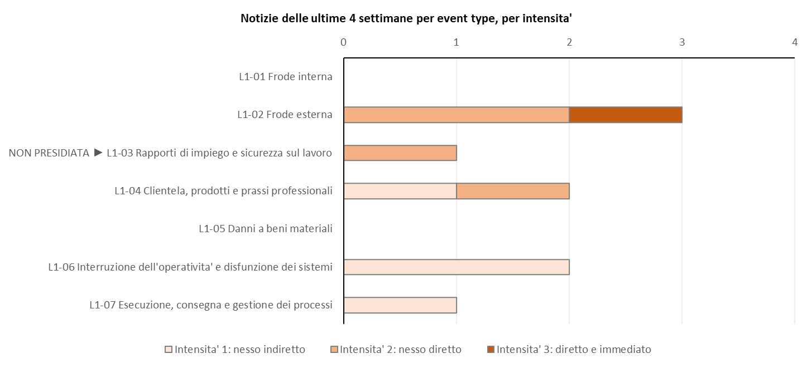

Sintesi della settimana e flag di A3 sono nel foglio Sintesi_Settimane e nel riquadro del foglio Notizie. Nella
validazione della settimana (5 righe) il segnale della notizia sulla region e' rettificato in Migliorativo.

## W3 — A4 su richiesta

Parere in `A4_parere_esempio.md` sulla notizia del rimborso obbligatorio: nessuno score proposto, nessuna persona
nominata, nessuna scrittura.

---

## W1 — ciclo 2026Q4

Il precontrollo dice "nessun rilievo" (impronta `79e6cb648606`). A1 fa quattro cose:
- **NFR-16 sale**: Probabilita da 2 a 3 (piano di successione della Banca a meta'), Prossimita da 1 a 2 (vertenza in
  corso dal 6 ottobre), Velocity valutata (3), ciascuna con l'evidenza datata. Scrive subito **due KRI e due azioni**;
- alza la Prossimita di NFR-01 da 4 a 5;
- aggiorna NFR-14 in osservazione (Probabilita da 2 a 3, un cavo danneggiato nel Mediterraneo orientale; Prossimita
  ancora 1) e conferma NFR-13 con il rapporto ENISA (orizzonte da 10 a 8 anni);
- registra un fenomeno non censito (truffe con QR code falsi, gia' coperto da NFR-01).

```
Ciclo 2026Q4 scritto: 13/13 rischi, zero errori di formula.
KRI: 26 righe di storico per il ciclo; usciti di vigore: nessuno.
Registro unico (D-79): nel radar 13 rischi su 15 posti; in osservazione 3; entrati nel radar NFR-16; usciti nessuno.
```

NFR-16 entra nell'anagrafica con l'owner "Da assegnare"; **9.11 diventa "Presidiata"**. NFR-15, non toccato da A1,
e' riportato. Validazione: 55 righe (15 rischi scritti da A1, 26 KRI, 14 azioni), tutte accettate senza toccarle.

## Riapertura della validazione per NFR-02 (D-76)

Dopo la validazione arriva un fatto nuovo: un secondo incidente del fornitore cloud in un mese. La funzione di
rischio riapre il solo NFR-02:

```
Validazione del ciclo 2026Q4 RIAPERTA (D-76): rischi 1, KRI 2, azioni 4, nel foglio Validazione.
```

Nella griglia c'e' il valore validato. Il validatore cambia due celle:
- **Probabilita da 2 a 4**: due punti, ammessi perche' in riapertura non vale il limite di un punto, con la
  Motivazione;
- valore di **NFR-02-K1 da 70 a 78** (dato definitivo dell'inventario).

`valida`: `7 righe — accettate 5, rettificate 2`. Lo score di NFR-02 passa da 3,30 a **3,80**, NFR-02-K1 diventa
Rosso, il livello di allerta passa ad **Attenzione**. Lo stato si ricalcola: NFR-02 resta nel radar.

### Quadro d'insieme (prima pagina del report)

| Numero | Valore |
|---|---|
| Rischi valutati | **13** su 13 (completo) |
| Livello di allerta | **2 · 6**: attivazione NFR-01 e NFR-11, attenzione 6, monitoraggio 5 |
| Variati · nuovi (radar) rispetto al 2026Q3 | **3 · 0** (NFR-01, NFR-02, NFR-16); sotto: entrati nel radar 1, usciti 0, in osservazione 3 |
| KRI in rosso | **3** su 26 in vigore |
| Validazione | ✓ |

Priorita' per score: NFR-01 4,40; NFR-02 3,80; NFR-07 3,75; NFR-12 3,65; NFR-03 3,00.

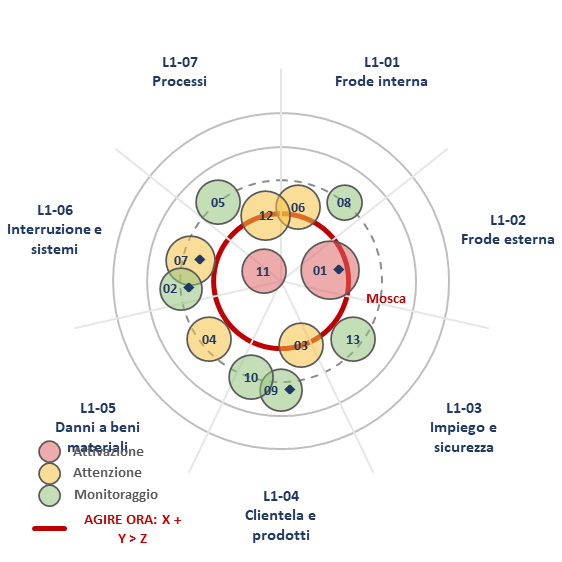

### Registro (foglio di lavoro, "il ciclo corrente": i rischi del radar)

Un rischio per riga, dal piu' alto per score (1-5, 5 = peggiore; pesi D-50: 0,35 Impatto, 0,25 Probabilita, 0,20
Prossimita, 0,20 Velocity). Presidio prima della correzione manuale del passo 10:

| ID | Cat. | Imp | Prob | Pross | Vel | Score | Δ | Urgenza | ◆ | KRI R/A/V | Segnali | Presidio |
|---|---|---|---|---|---|---|---|---|---|---|---|---|
| NFR-01 | 9.7 | 4 | 4 | 5 | 5 | 4,40 | +0,20 | AGIRE ORA | ◆ | 1/0/1 | ▲ +3 | Parziale |
| NFR-02 | 9.9 | 4 | **4** | 3 | 4 | **3,80** | **+0,50** | Margine 1 anno | ◆ | 1/0/1 | ● -1 | Non verificato |
| NFR-07 | 9.9 | 4 | 3 | 3 | 5 | 3,75 | 0 | Entro l'anno | ◆ | 0/1/1 | ● 0 | Parziale |
| NFR-12 | 9.13 | 3 | 4 | 4 | 4 | 3,65 | 0 | Entro l'anno |  | 0/1/1 | ● 0 | Parziale |
| NFR-03 | 9.1 | 3 | 3 | 4 | 2 | 3,00 | 0 | Entro l'anno |  | 0/2/0 | ● 0 | Non verificato |
| NFR-05 | 9.13 | 3 | 3 | 3 | 3 | 3,00 | 0 | Margine 1 anno |  | 0/0/2 | ● 0 | Adeguato |
| NFR-06 | 9.7 | 3 | 3 | 3 | 3 | 3,00 | 0 | Entro l'anno |  | 0/0/2 | ● 0 | Assente |
| NFR-10 | 9.1 | 3 | 3 | 3 | 3 | 3,00 | 0 | Margine 1 anno |  | 0/2/0 | ● 0 | Non verificato |
| NFR-09 | 9.4 | 4 | 2 | 2 | 3 | 2,90 | 0 | Margine 1,3 anni | ◆ | 0/2/0 | ● 0 | Non verificato |
| NFR-04 | 9.8 | 3 | 3 | 3 | 2 | 2,80 | 0 | Entro l'anno |  | 0/1/1 | ● 0 | Non verificato |
| NFR-11 | 9.6 | 3 | 3 | 3 | 2 | 2,80 | 0 | AGIRE ORA |  | 1/1/0 | ● 0 | Assente |
| **NFR-16** | 9.11 | 3 | 3 | 2 | 3 | 2,80 | +0,61 (era in osservazione) | Margine 1,8 anni |  | 0/0/0 | ● +1 | Non verificato |
| NFR-08 | 9.7 | 3 | 2 | 3 | 3 | 2,75 | 0 | Margine 1 anno |  | 0/0/2 | ● 0 | Non verificato |

KRI in vigore: 26, due per rischio del radar. Sono 11 Verde, 10 Ambra, 3 Rosso (NFR-01-K1, NFR-02-K1, NFR-11-K2) e
2 Non rilevato (i due di NFR-16, appena nati).

### Fenomeni (pagina del report): i rischi in osservazione

In testa: "Registro unico: nel radar 13 rischi (capienza 15), in osservazione 3 (al massimo 20) · nel ciclo: entrati
nel radar 1, usciti 0, in uscita 0". Poi i rischi in osservazione, dal piu' alto per score, con il perche' sono fuori
dal radar; sotto, chi e' entrato o uscito.

| Rischio | Imp · Prob · Pross · Vel | Score | Perche' fuori dal radar | Orizzonte |
|---|---|---|---|---|
| NFR-14 cavi sottomarini | 4 · 3 · 1 · 4 | 3,15 | Prossimita 1 sotto la soglia 2 | 4 anni |
| NFR-13 calcolo quantistico | 5 · 1 · 1 · — | 2,75 | Prossimita e Probabilita sotto la soglia | 8 anni |
| NFR-15 agenti di IA | 3 · 1 · 2 · — | 2,13 | Probabilita 1 sotto la soglia 2 | 4 anni |

Entrati e usciti: **NFR-16, Entrato** ("Prossimita 2 e Probabilita 3: sopra la soglia"). NFR-14 ha uno score piu' alto
di NFR-08, che e' nel radar: e' fuori perche' non puo' manifestarsi entro 3 anni, non per lo score. E' il motivo per cui
la regola usa le soglie e non solo la classifica.

> **Corretto dopo questa demo.** Nel PDF di questo giro la riga "NFR-16, Entrato" non si vedeva: le righe di entrati e
> usciti restavano alte 3 punti, come nel template. Ora lo script ne adatta l'altezza al testo, come per l'elenco dei
> rischi (`prepara_report`); il dato nel registro era gia' giusto.

### Classifica, Radar_Mosca, Delta, Storico, Indicatori, Notizie

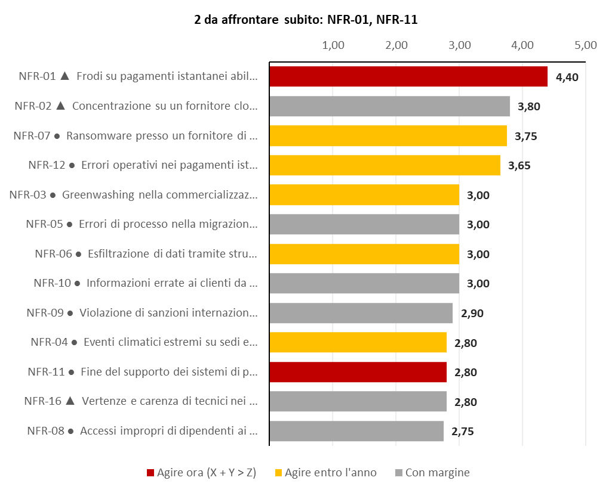
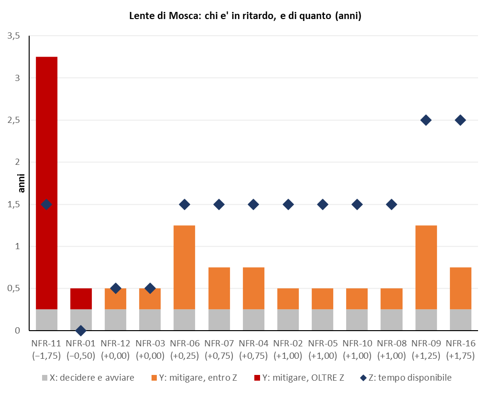
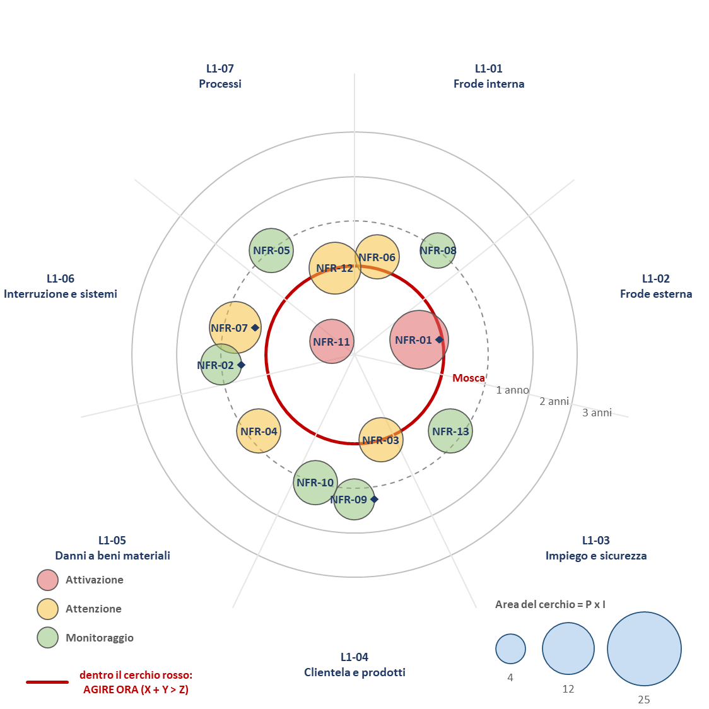
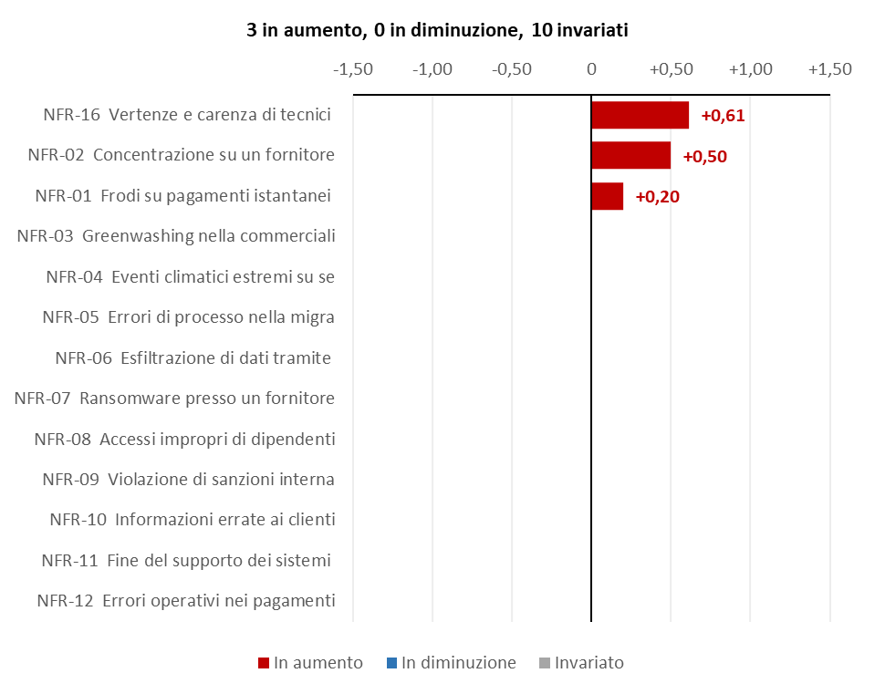
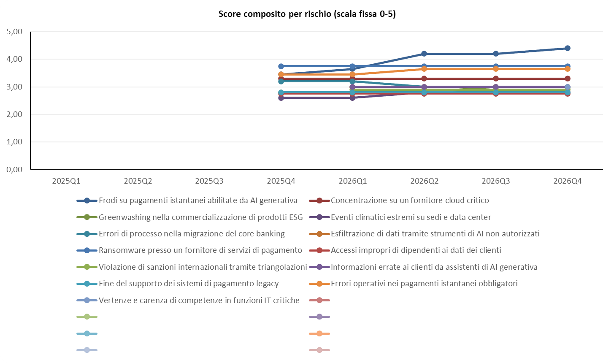
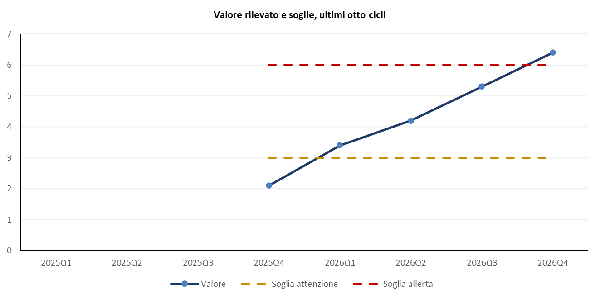
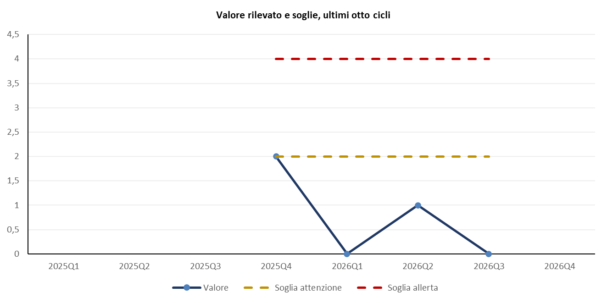
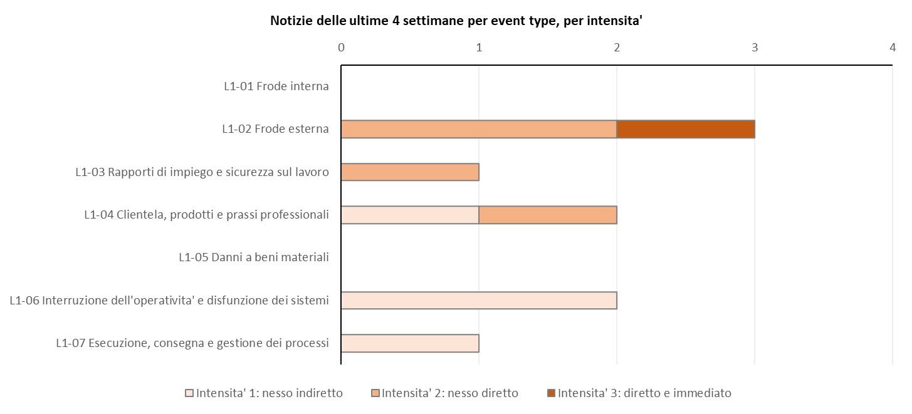

### Schede dei rischi e report al comitato

`schede-input` e `schede` (senza A6) producono `Schede_2026Q4.xlsx`, un indice e 13 schede (i rischi del radar) con
il razionale in parti, il perche' di ogni valore, azioni e KRI con "Perche'" ed "Effetto atteso".

Il report al comitato si fa in due passi:
1. `report` scrive `Report_comitato_2026Q4.pdf`, 13 pagine: Quadro, Classifica, Radar_Mosca, Matrice, Delta,
   **Fenomeni** (i rischi in osservazione) e Metodologia (con la regola del registro unico);
2. il validatore corregge a mano il presidio dei controlli di NFR-02 (da Non verificato a Parziale);
   `report --con-lavoro` rigenera il PDF, ora di 16 pagine con Registro e Parametri (che documenta la regola del
   radar alle righe 65-75). Il PDF di prima resta con la data e l'ora nel nome.

---

## Ciclo straordinario 2026Q4-S1, fatto da A8 (D-75, D-77)

**Settimana del 16/11/2026.** Una sola notizia: il primo caso in Italia di frode con voce clonata ai danni del
cliente corporate di una banca comparabile (intensita' 3 su 9.7, NFR-01 ha Impatto 4). A3 applica la regola del
segnale critico:

```
PROPOSTA DI CICLO STRAORDINARIO di A3 per NFR-01: Intensita' 3 su NFR-01, che ha Impatto 4: il primo caso presso una banca comparabile rende superato il descrittore di Probabilita 4.
```

**Decisione** (dopo un caso presso un cliente della Banca, 12/01/2027):

```
CICLO STRAORDINARIO 2026Q4-S1 deciso da Comitato Rischi (D-75): rischi da rivalutare NFR-01; data di riferimento 2027-01-20.
```

**A8** (`A8_2026Q4-S1.json`) riscrive solo NFR-01: Probabilita da 4 a 5, perche' il fenomeno e' ora osservato presso
la Banca. **Rilegge i due KRI di NFR-01** (D-77, punto 4) e scrive l'**analisi dell'evento**: il fatto, la catena
causale, i rischi toccati (NFR-01 e, senza poterlo riscrivere, NFR-07), i rischi vicini non toccati e perche', i
documenti letti, i limiti.

Il **precontrollo** parla ad A8 e non ferma:

```
Precontrollo dell'output di A8 (2026Q4-S1): 0 punti da correggere, 1 da verificare.
Impronta dell'output di A8: 778f10489ca4
1. NFR-07 · C1: analisi_evento: rischio toccato dall'evento ma non indicato per lo straordinario: la funzione di rischio valuti se rivalutarlo (un altro straordinario o il trimestre).
```

**Scrittura e validazione**:

```
CICLO STRAORDINARIO 2026Q4-S1 (D-75): rivalutati NFR-01; gli altri rischi sono riportati dal ciclo prima, gia' validati.
Ciclo 2026Q4-S1 scritto: 13/13 rischi, zero errori di formula.
Registro unico (D-79): nel radar 13 rischi su 15 posti; in osservazione 3; entrati nel radar nessuno; usciti nessuno.
```

- i 12 rischi del radar non rivalutati e i 3 in osservazione sono riportati gia' validati, con il loro stato;
- la validazione ha 4 righe (il rischio, i suoi due KRI, l'azione nuova), tutte accettate;
- NFR-01 passa da 4,40 a **4,65**; per gli altri rischi lo score non cambia.

La colonna Straordinario di **Sintesi_Cicli** dice chi ha deciso, il motivo, i rischi rivalutati e il fatto
dell'analisi di A8; la knowledge di A7 (`Spiegazioni/Ciclo.txt`) ha l'analisi intera, i rischi in osservazione con il
perche' e chi e' entrato o uscito.

Quadro dello straordinario: l'etichetta e' "Ciclo straordinario 2026Q4-S1 · dati al 20/01/2027". Livello di allerta
**2 · 6** (attivazione NFR-01 e NFR-11), variati · nuovi 1 · 0 rispetto al 2026Q4, 3 KRI in rosso.

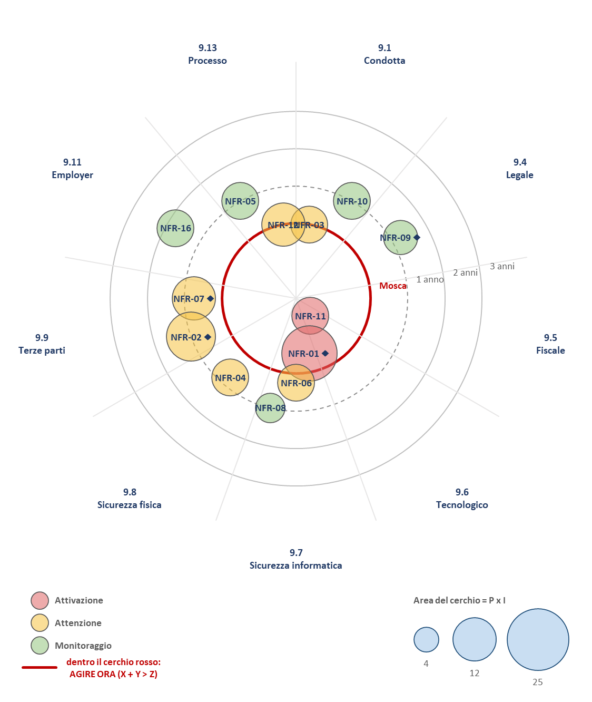
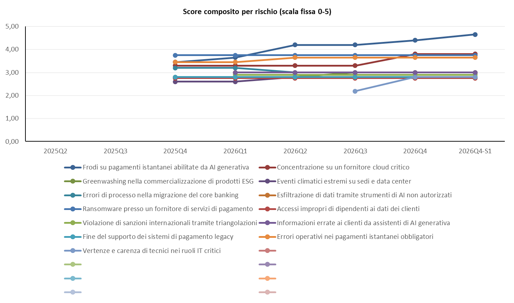

Dopo la validazione la baseline e l'allegato sono per il **2027Q1**, che parte dai valori dello straordinario
(`Input_A1_2027Q1.txt`).

---

## Cosa la demo non mostra (ma il collaudo si')

La demo parte dal template con i dati di esempio. La catena di collaudo (`99_Collaudo/run_catena.py`) prova anche:
- il **registro unico** fino in fondo (passo 14): un rischio sotto la soglia resta un ciclo "Radar, in uscita" ed esce
  al secondo; le decisioni del validatore sullo stato (Radar, Osservazione) con la motivazione obbligatoria; la
  capienza del radar ridotta; la dismissione di un rischio in osservazione;
- la **conversione** di un registro con la vecchia lista di osservazione (passo 11c);
- il **primo uso reale** (`inizializza`) e la **dismissione di un rischio** (`dismetti`);
- l'**aggiornamento di un registro vecchio** (`aggiorna-registro`);
- la riapertura completa, con KRI respinto, azione rettificata e decisione sullo stato (passo 13);
- lo **straordinario di solo censimento** fatto da A8, con un rischio nuovo creato dall'evento (passo 8a);
- il **gate di copertura**: un rischio del radar che manca dall'output ferma il ciclo, non sparisce;
- i casi di errore: esito di A5 di un altro ciclo, titoli che iniziano con "=", file non JSON o con BOM.

## Dove sono i file

```text
Demo_W1_W2/
  NFR_Registro.xlsx                     registro VIVO: cresce a ogni run
  News_Inbox/2026-10-05/                raccolta REALE dai feed
  1_Input_agenti/                       output simulati degli agenti (A1, A3, A5, A8), decisioni simulate del validatore,
                                        baseline date agli agenti, allegati Input_A1 del 2026Q3, 2026Q4 e 2026Q4-S1
  A4_parere_esempio.md                  parere di A4
  Archivio_Cicli/                       NON nel repository ne' nello zip (dal 13/10): lo ricrea esegui_demo.py a ogni run
    Baseline_corrente.json / .txt       input degli agenti per il prossimo run (valori validati, rischi in osservazione,
                                        regola del radar)
    Input_A1_2027Q1.txt                 allegato di A1 per il prossimo ciclo
    Spiegazioni/                        knowledge di A7: Ciclo.txt e Rischio_01..20.txt
    Cicli/2026Q3/                       registro scritto e validato, output degli agenti, baseline usata, esito dei
                                        controlli, Validazione_2026Q3.json, Correzione_A1_2026Q3.txt
    Cicli/2026Q3/tentativo_<ora>/       ogni tentativo, anche quello fermato
    Cicli/2026Q4/                       idem, piu' schede e Report_comitato_2026Q4.pdf (e la versione precedente)
    Cicli/2026Q4-S1/                    lo straordinario: Straordinario_2026Q4-S1.json (la decisione), registro scritto
                                        e validato, output di A8 (archiviato come A1_2026Q4-S1.json)
    Settimane/2026-10-12/, 2026-11-16/  Excel della settimana, validato, output di A3
    Backup/                             il registro vivo prima di ogni scrittura
  Grafici/                              immagini dell'Excel del 2026Q4, Radar_Mosca e Storico dello straordinario,
                                        Validazione_2026Q3.pdf
```
